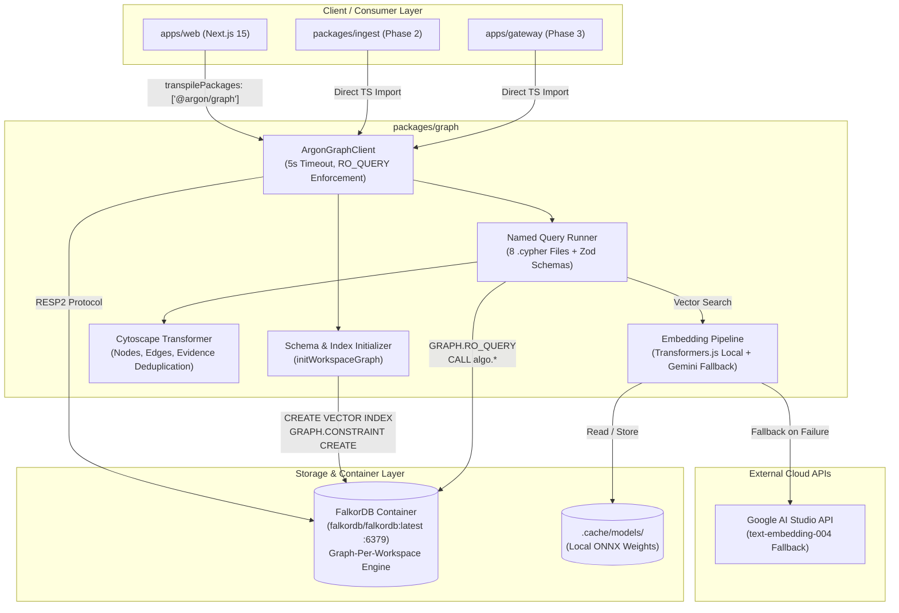
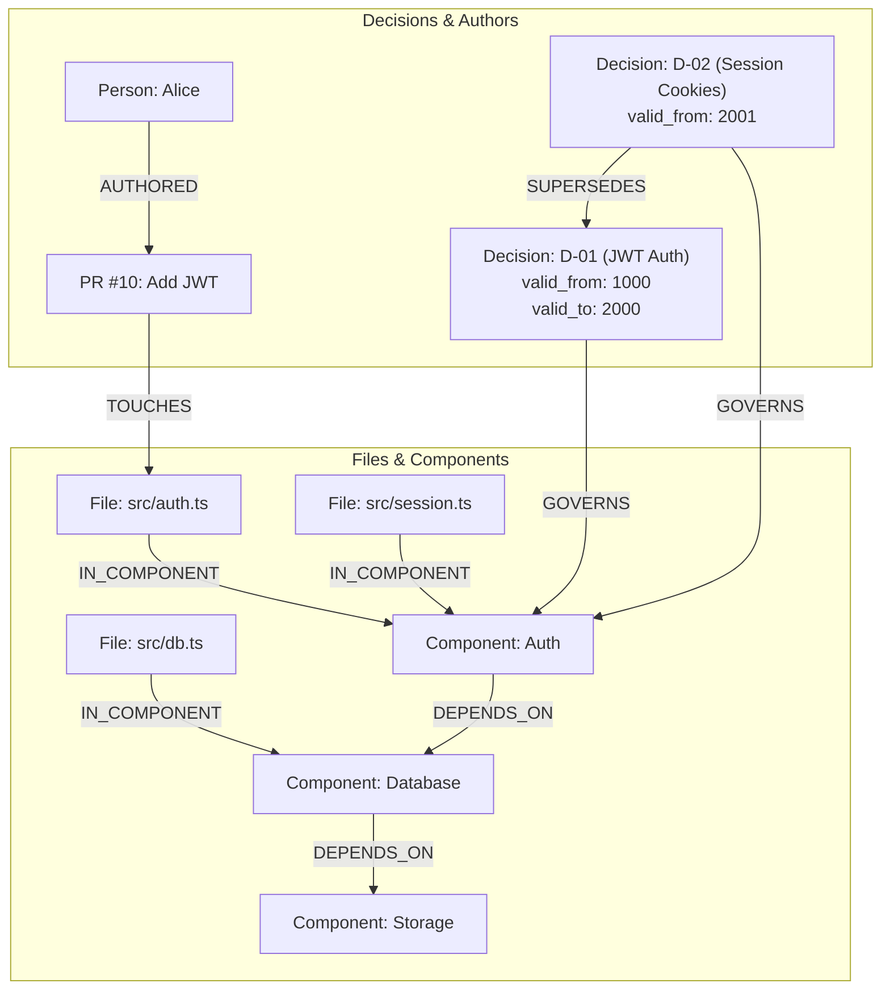

# Phase 1: Database Schema & Vector Foundation - Research

**Researched:** 2026-10-15  
**Domain:** FalkorDB openCypher, Vector Indexing (512-d Cosine), Transformers.js CPU Embeddings, Turborepo Monorepo Architecture, Cytoscape Serialization  
**Confidence:** HIGH  

---

<user_constraints>
## User Constraints (from CONTEXT.md)

### Locked Decisions

- **D-01: Monorepo Tooling** — Monorepo orchestrated with Turborepo + pnpm workspaces with shared tsconfig/eslint for task caching and unified dev/build pipelines.
- **D-02: Next.js Workspace Scaffolding** — Scaffold `apps/web` in Phase 1 with Next.js 15 (App Router), Tailwind CSS v4, and shadcn base to verify cross-package workspace imports and TypeScript resolution from day one.
- **D-03: Direct TypeScript Source Consumption** — Internal packages (`packages/graph`, `packages/common`) consumed directly via TypeScript sources (`transpilePackages` in Next.js, `tsx` in Node.js) with no intermediate build/dist step required for local dev.
- **D-04: Brutalist Visual Tokens** — Pre-configure dark mode cyberpunk brutalist tokens in Tailwind CSS v4 + lucide-react in `apps/web` to establish the terminal visual language specified in PRD §6.4.
- **D-05: Official FalkorDB Driver** — Use the official `falkordb` npm client for graph connection, graph-per-workspace selection (`db.selectGraph(workspaceId)`), native record parsing, and vector indexing.
- **D-06: Local FalkorDB Orchestration** — Provision local FalkorDB via root `docker-compose.yml` (port 6379, persistent volume) with a `pnpm db:up` command and container healthcheck, used for both local development and Vitest integration tests.
- **D-07: Idempotent Schema Initializer** — Implement programmatic idempotent schema initialization (`initWorkspaceGraph(workspaceId)`) in `packages/graph` that verifies and applies constraints and 512-d vector indexes automatically on first workspace connection, with an optional CLI migration command (`pnpm db:schema:apply`).
- **D-08: ArgonGraphClient Wrapper** — Implement custom `ArgonGraphClient` wrapper enforcing a 5000ms query timeout, typed `FalkorUnavailableError` (powering the PRD §7.4 "no graph, no answer" refusal contract), and strict `RO_QUERY` dispatch for agent/read operations.
- **D-09: Cypher File Isolation** — Author the 8 named queries as standalone `.cypher` files in `packages/graph/queries/*.cypher` with a runtime/build loader to maintain clean syntax highlighting and direct CLI testability.
- **D-10: Strict Zod Contracts** — Define strict Zod validation schemas with inferred TypeScript types (`z.infer`) for query input parameters and returned record shapes, guaranteeing runtime contract safety.
- **D-11: Cytoscape Dual-Payload** — Return a normalized dual-payload format from named queries: `{ raw: TRecords, graph: CytoscapeElements, evidence: EvidenceSummary }` ready for Cytoscape.js rendering and Gemma 4 evidence narration without client-side mapping duplication.
- **D-12: Integration Test Harness** — Verify all 8 named queries using a deterministic synthetic fixture graph (`seed-fixture.ts`) in Vitest running against a live FalkorDB instance, asserting exact traversals, PageRank algorithms, temporal validity filters, and vector search recall.
- **D-13: Primary Embedding Model** — Primary local embedder configured with `onnx-community/embeddinggemma-2-ONNX` (q8 quantization, 512-d Matryoshka truncation with L2 norm = 1.0) on Node.js CPU via Transformers.js.
- **D-14: Model Cache Path** — Store downloaded ONNX model weights in project-level `.cache/models/` (git-ignored) with a `TRANSFORMERS_CACHE` environment variable override for reproducible, isolated Docker caching.
- **D-15: Transparent Provider Fallback** — Implement transparent fallback controlled by `EMBEDDING_PROVIDER=local|gemini|auto`: attempts local Transformers.js embedder first, automatically falls back to Gemini API (`text-embedding-004`) on ONNX failure or timeout while logging telemetry.
- **D-16: Mathematical Vector Assertions** — Unit test suite enforces strict mathematical assertions: output vector dimension === 512, L2 norm `abs(sum(v_i^2) - 1.0) < 1e-4`, and semantic clustering sanity tests.

### the agent's Discretion

- Exact directory layout within `packages/graph` (`src/client.ts`, `src/queries/`, `src/embedding/`, `src/schema/`).
- Choice between embedding queries as raw text at compile time or reading with `fs` in Node.js with safe fallback.
- Docker compose service naming and volume mount paths (`.falkordb-data/`).

### Deferred Ideas (OUT OF SCOPE)

- Repository cloning, co-change mining, or git ingest workers (Phase 2).
- Hono gateway HTTP service and agent narration (Phase 3).
- Full interactive UI command bar and Cytoscape canvas integration (Phase 4).
- Git revert backtest and showcase corpus ingestion (Phase 5).
</user_constraints>

---

<architectural_responsibility_map>
## Architectural Responsibility Map

| Capability | Primary Tier | Secondary Tier | Rationale |
|------------|-------------|----------------|-----------|
| Graph Connection & Execution (`ArgonGraphClient`) | Backend Package (`packages/graph`) | Database/Storage (`FalkorDB`) | Centralizes connection pooling, query timeouts, and `RO_QUERY` vs `QUERY` dispatch. |
| Schema & Index Provisioning (`initWorkspaceGraph`) | Backend Package (`packages/graph`) | Database/Storage (`FalkorDB`) | Idempotent DDL execution creates range indexes, vector indexes, and uniqueness constraints. |
| 8 Named Queries (`.cypher`) | Backend Package (`packages/graph`) | Database/Storage (`FalkorDB`) | Cypher files define the analytical queries; FalkorDB executes graph traversals & matrix algorithms. |
| Query Validation & Cytoscape Serialization | Backend Package (`packages/graph`) | Frontend App (`apps/web`) | Validates parameters with Zod and converts raw openCypher paths into Cytoscape `{ nodes, edges }`. |
| Local ONNX & Cloud Embedding (`embedding.ts`) | Backend Package (`packages/graph`) | External API (`Google AI Studio`) | Computes 512-d normalized vectors on CPU via Transformers.js with automatic Gemini fallback. |
| Monorepo & UI Shell Scaffolding | Frontend App (`apps/web`) | Tooling (`Turborepo` / `pnpm`) | Verifies cross-package resolution and establishes brutalist dark theme tokens. |
| Local Database Container | Tooling (`docker-compose.yml`) | Database/Storage (`FalkorDB`) | Provides persistent FalkorDB instance on port 6379 with health checks for dev & Vitest. |
</architectural_responsibility_map>

---

<research_summary>
## Summary

Argon's foundation relies on a graph-first architecture where **FalkorDB is the single source of truth** for both knowledge graphs and operational states. FalkorDB operates via the Redis RESP2 protocol using an internal sparse adjacency matrix engine (GraphBLAS), providing low-latency traversals, native matrix algorithms (`algo.pageRank`, `algo.SPpaths`, `algo.labelPropagation`), and native vector similarity search via `CREATE VECTOR INDEX`.

The Node.js integration layer (`packages/graph`) uses the official `falkordb` npm package (v6.8.0). To fulfill the "no graph, no answer" architectural principle, `ArgonGraphClient` wraps FalkorDB calls with a strict 5000ms timeout and translates underlying socket failures into typed `FalkorUnavailableError` instances. Furthermore, read queries must strictly execute through `graph.roQuery()` to prevent any unintended graph mutation during briefing synthesis.

For semantic search, Argon uses Google's `EmbeddingGemma-2` model running locally on Node.js CPU via `@huggingface/transformers` (v4.3.1). The model generates 768-dimensional representations which are truncated via Matryoshka Representation Learning (MRL) to **512 dimensions** and strictly re-normalized to unit length ($L_2 = 1.0$) to maintain cosine geometry in FalkorDB. A transparent fallback layer delegates to the Gemini API (`@google/genai` v2.30.0 with `text-embedding-004`) if local ONNX inference times out or runs out of memory.

**Primary recommendation:** Build `packages/graph` as a self-contained TypeScript workspace exporting `ArgonGraphClient`, `initWorkspaceGraph`, typed query runners with Zod contracts, and the 512-d MRL embedder. Connect `apps/web` (Next.js 15 App Router) directly via `transpilePackages` to ensure clean monorepo boundary verification.
</research_summary>

---

<standard_stack>
## Standard Stack

### Core

| Library | Version | Purpose | Why Standard |
|---------|---------|---------|--------------|
| `falkordb` | `^6.8.0` | Official FalkorDB TypeScript/Node client | Native connection pooling, graph-per-workspace selection (`db.selectGraph`), openCypher parsing, and `roQuery` support. |
| `@huggingface/transformers` | `^4.3.1` | Local ONNX embedding execution on CPU | Successor to `@xenova/transformers` (v2.17.2). Native `onnxruntime-node` backend, supports MRL models and local directory caching. |
| `@google/genai` | `^2.30.0` | Google Gen AI official unified SDK | Fast, modern fallback client for `text-embedding-004` (with native `outputDimensionality: 512`). |
| `zod` | `^3.24.2` | Runtime validation for query parameters & results | Guarantees strict runtime data contracts before sending data to LLM narration or frontend canvas. |
| `turbo` | `^2.4.4` | Monorepo task orchestration & build caching | Caches lint, test, and typecheck tasks across `apps/*` and `packages/*`. |
| `next` | `^15.2.0` | React application framework (App Router) | Production standard for full-stack React with native `transpilePackages` support. |
| `tailwindcss` | `^4.0.0` | Utility-first CSS styling | High-performance CSS v4 engine with `@theme` token definitions. |
| `vitest` | `^3.2.0` | Fast TypeScript unit and integration test runner | Native ESM and TypeScript support with seamless Docker integration test workflows. |

### Supporting

| Library | Version | Purpose | When to Use |
|---------|---------|---------|-------------|
| `clsx` + `tailwind-merge` | `^2.1.1` / `^3.0.0` | Dynamic CSS class merging | Used in UI components to combine conditional utility classes safely. |
| `lucide-react` | `^1.16.0` | Brutalist icon set | Terminal, graph, and evidence card iconography in `apps/web`. |
| `tsx` | `^4.19.3` | Direct TypeScript execution in Node.js | Running seed fixtures, CLI schema migration scripts, and scratch benchmarks without compile step. |
| `dotenv` | `^16.4.7` | Environment variable loader | Loading `FALKORDB_URL`, `EMBEDDING_PROVIDER`, and `GEMINI_API_KEY` in scripts and tests. |
| `@types/node` | `^22.13.0` | Node.js standard library type definitions | TypeScript compilation for Node APIs (`fs`, `path`, `process`). |

### Alternatives Considered

| Instead of | Could Use | Tradeoff |
|------------|-----------|----------|
| `falkordb` | `@redis/client` raw commands | Raw client requires hand-rolling FalkorDB RESP table and path parsers. |
| `@huggingface/transformers` | `@xenova/transformers` (v2) | v2 is frozen; v3/v4 has active bugfixes for modern ONNX operators and embedding architectures. |
| `@huggingface/transformers` | Python sidecar / Cloud Run embedder | Adds Docker container overhead (1.5GB+), HTTP serialization latency, and cold starts. |
| `Turborepo` | Lerna / Nx | Turborepo provides zero-config pnpm workspace caching without Nx complexity. |

**Workspace Installation Commands:**
```bash
# In packages/graph
pnpm --filter @argon/graph add falkordb @huggingface/transformers @google/genai zod dotenv
pnpm --filter @argon/graph add -D vitest tsx @types/node typescript

# In apps/web
pnpm --filter web add next react react-dom lucide-react clsx tailwind-merge
pnpm --filter web add -D tailwindcss @tailwindcss/postcss postcss typescript @types/react @types/node
```
</standard_stack>

---

<architecture_patterns>
## Architecture Patterns

### System Architecture Diagram



### Recommended Project Structure

```
argon/
├── apps/
│   └── web/                                # Next.js 15 App Router Frontend
│       ├── app/
│       │   ├── globals.css                 # Tailwind v4 brutalist tokens
│       │   ├── layout.tsx
│       │   └── page.tsx
│       ├── next.config.ts                  # transpilePackages: ['@argon/graph']
│       ├── package.json
│       └── tsconfig.json
├── packages/
│   ├── graph/                              # Core FalkorDB & Vector Foundation
│   │   ├── queries/                        # Standalone openCypher query files
│   │   │   ├── 01_resolve_scope.cypher
│   │   │   ├── 02_blast_radius.cypher
│   │   │   ├── 03_risk_ranking.cypher
│   │   │   ├── 04_who_knows.cypher
│   │   │   ├── 05_constraining_decisions.cypher
│   │   │   ├── 06_precedent_search.cypher
│   │   │   ├── 07_path_between.cypher
│   │   │   └── 08_component_overview.cypher
│   │   ├── src/
│   │   │   ├── client.ts                   # ArgonGraphClient & FalkorUnavailableError
│   │   │   ├── contracts.ts                # Zod schemas for parameters and returns
│   │   │   ├── cytoscape.ts                # Graph query -> CytoscapeElements transformer
│   │   │   ├── embedding.ts                # 512-d MRL embedder with Gemini fallback
│   │   │   ├── index.ts                    # Main package entrypoint
│   │   │   ├── queries.ts                  # Typed query dispatchers
│   │   │   └── schema/
│   │   │       ├── init.ts                 # Idempotent initWorkspaceGraph function
│   │   │       └── schema.cypher           # DDL schema reference
│   │   ├── test/
│   │   │   ├── client.test.ts              # Connection & timeout unit tests
│   │   │   ├── embedding.test.ts           # Math, dimension & L2 norm tests
│   │   │   ├── queries.test.ts             # 8 queries against live FalkorDB
│   │   │   └── seed-fixture.ts             # Deterministic synthetic fixture graph
│   │   ├── package.json
│   │   ├── tsconfig.json
│   │   └── vitest.config.ts
│   └── tsconfig/                           # Shared TypeScript configs
│       ├── base.json
│       ├── nextjs.json
│       └── package.json
├── .cache/                                 # Git-ignored model weights & artifacts
│   └── models/
├── docker-compose.yml                      # FalkorDB local container orchestration
├── pnpm-workspace.yaml                     # pnpm workspace definition
├── turbo.json                              # Turborepo task pipeline configuration
├── package.json                            # Root package.json
└── tsconfig.json                           # Root tsconfig
```

### Pattern 1: `ArgonGraphClient` with 5s Timeout and `RO_QUERY` Safety

**What:** Encapsulates the FalkorDB connection, enforces strict 5000ms query timeouts, translates Redis disconnection errors to `FalkorUnavailableError` ("no graph, no answer"), and routes read operations exclusively through `roQuery()`.  
**When to use:** All database interactions across ingestion, gateway, and test suites.

```typescript
import { FalkorDB } from 'falkordb';

export class FalkorUnavailableError extends Error {
  constructor(message: string, public readonly cause?: unknown) {
    super(`FalkorDB is unavailable: ${message}`);
    this.name = 'FalkorUnavailableError';
  }
}

export interface ArgonClientConfig {
  url?: string;
  timeoutMs?: number;
}

export class ArgonGraphClient {
  private client: FalkorDB | null = null;
  private readonly url: string;
  private readonly defaultTimeout: number;

  constructor(config?: ArgonClientConfig) {
    this.url = config?.url ?? process.env.FALKORDB_URL ?? 'falkor://localhost:6379';
    this.defaultTimeout = config?.timeoutMs ?? 5000;
  }

  async connect(): Promise<void> {
    try {
      this.client = await FalkorDB.connect({
        url: this.url,
        socket: { connectTimeout: this.defaultTimeout },
      });
    } catch (err) {
      throw new FalkorUnavailableError('Failed to establish connection', err);
    }
  }

  getGraph(workspaceId: string) {
    if (!this.client) {
      throw new FalkorUnavailableError('Client not connected');
    }
    return this.client.selectGraph(workspaceId);
  }

  async readOnlyQuery<T = unknown>(
    workspaceId: string,
    query: string,
    params: Record<string, unknown> = {},
    timeoutMs?: number
  ) {
    const graph = this.getGraph(workspaceId);
    try {
      return await graph.roQuery<T>(query, {
        params,
        TIMEOUT: timeoutMs ?? this.defaultTimeout,
      });
    } catch (err: any) {
      if (err.message?.includes('Connection closed') || err.message?.includes('ECONNREFUSED')) {
        throw new FalkorUnavailableError('Connection lost during query', err);
      }
      throw err;
    }
  }

  async close(): Promise<void> {
    if (this.client) {
      await this.client.close();
      this.client = null;
    }
  }
}
```

### Pattern 2: Idempotent Schema & Vector Index Initialization

**What:** Ensures that every workspace graph initializes required range indexes, unique constraints, and the 512-d vector index without throwing errors if they already exist.  
**When to use:** On workspace creation, before ingestion begins, and in test setup.

```typescript
import { FalkorDB, ConstraintType, EntityType } from 'falkordb';

export async function initWorkspaceGraph(client: FalkorDB, workspaceId: string): Promise<void> {
  const graph = client.selectGraph(workspaceId);

  // 1. Create standard range indexes
  const indexStatements = [
    'CREATE INDEX FOR (p:Person) ON (p.id)',
    'CREATE INDEX FOR (c:Component) ON (c.name)',
    'CREATE INDEX FOR (f:File) ON (f.path)',
    'CREATE INDEX FOR (pr:PullRequest) ON (pr.number)',
    'CREATE INDEX FOR (d:Decision) ON (d.id)',
    'CREATE INDEX FOR (b:Briefing) ON (b.id)',
    'CREATE INDEX FOR (j:IngestJob) ON (j.id)',
  ];

  for (const stmt of indexStatements) {
    try {
      await graph.query(stmt);
    } catch (err: any) {
      // Ignore if index already exists
      if (!err.message?.includes('already indexed') && !err.message?.includes('already exists')) {
        throw err;
      }
    }
  }

  // 2. Create Uniqueness Constraints using FalkorDB client API
  const uniqueConstraints = [
    { label: 'Person', prop: 'id' },
    { label: 'Component', prop: 'name' },
    { label: 'File', prop: 'path' },
    { label: 'PullRequest', prop: 'number' },
    { label: 'Decision', prop: 'id' },
    { label: 'IngestJob', prop: 'id' },
  ];

  for (const { label, prop } of uniqueConstraints) {
    try {
      await graph.constraintCreate(ConstraintType.UNIQUE, EntityType.NODE, label, prop);
    } catch (err: any) {
      if (!err.message?.includes('already exists') && !err.message?.includes('Constraint already exists')) {
        throw err;
      }
    }
  }

  // 3. Create 512-dimension Cosine Vector Index on Decision.embedding
  try {
    await graph.query(
      `CREATE VECTOR INDEX FOR (d:Decision) ON (d.embedding) OPTIONS {dimension: 512, similarityFunction: 'cosine'}`
    );
  } catch (err: any) {
    if (!err.message?.includes('already exists') && !err.message?.includes('already indexed')) {
      throw err;
    }
  }
}
```

### Pattern 3: Normalized Dual-Payload Cytoscape Transformer

**What:** Converts tabular openCypher replies containing nodes, edges, and paths into a deduplicated `{ raw, graph: CytoscapeElements, evidence }` structure ready for Cytoscape.js rendering.  
**When to use:** Wrapping the output of all named query execution functions.

```typescript
export interface CytoscapeNode {
  data: {
    id: string;
    label: string;
    type: string;
    properties: Record<string, unknown>;
  };
}

export interface CytoscapeEdge {
  data: {
    id: string;
    source: string;
    target: string;
    label: string;
    properties: Record<string, unknown>;
  };
}

export interface CytoscapeElements {
  nodes: CytoscapeNode[];
  edges: CytoscapeEdge[];
}

export interface DualPayload<TRaw> {
  raw: TRaw;
  graph: CytoscapeElements;
  evidence: {
    nodeCount: number;
    edgeCount: number;
    primaryIds: string[];
  };
}
```

### Pattern 4: 512-d Matryoshka Truncation & L2 Normalization

**What:** Extracts embeddings from `EmbeddingGemma-2`, truncates the 768-d tensor to 512-d, and strictly applies unit L2 normalization ($L_2 = 1.0$).  
**When to use:** All text embedding generation before writing to FalkorDB or running vector search.

```typescript
export function processMatryoshkaVector(rawFloats: number[] | Float32Array, targetDim = 512): number[] {
  // 1. Truncate using Matryoshka slicing
  const sliced = Array.from(rawFloats.slice(0, targetDim));

  // 2. Compute L2 norm: sqrt(sum(v_i^2))
  const norm = Math.hypot(...sliced);

  if (norm === 0) {
    return new Array(targetDim).fill(0);
  }

  // 3. Re-normalize to unit length
  return sliced.map((val) => val / norm);
}
```

### Anti-Patterns to Avoid

- **Querying with `graph.query()` for Agent Operations:** Agents and read queries must exclusively use `graph.roQuery()` to guarantee read-only execution at the database level.
- **Using Neo4j `CREATE CONSTRAINT` Syntax:** FalkorDB does not support `CREATE CONSTRAINT FOR ...` in Cypher. Unique constraints must be established via `graph.constraintCreate()` or `GRAPH.CONSTRAINT CREATE`.
- **Skipping L2 Re-normalization After Truncation:** Truncating a 768-d normalized vector leaves it with an L2 norm $< 1.0$. Failing to re-normalize silently degrades cosine similarity search accuracy in FalkorDB.
- **Passing Raw Undifferentiated Strings to EmbeddingGemma:** EmbeddingGemma-2 requires task prefixes (`task: search result | query: ...` vs `title: ... | text: ...`). Omitting prefixes leads to poor retrieval accuracy.
- **Allowing Duplicate Cytoscape Element IDs:** Cytoscape.js throws a fatal client exception if two nodes or edges have identical IDs. The transformer must maintain ID sets during serialization.
</architecture_patterns>

---

<dont_hand_roll>
## Don't Hand-Roll

| Problem | Don't Build | Use Instead | Why |
|---------|-------------|-------------|-----|
| Graph Traversal & Blast Radius | Custom recursive JavaScript node loops | openCypher variable-length paths `[:DEPENDS_ON*1..3]` | FalkorDB computes traversals in C using sparse matrix multiplication orders of magnitude faster. |
| PageRank & Node Centrality | In-memory JS PageRank calculation | FalkorDB native `CALL algo.pageRank()` | GraphBLAS executes parallel PageRank across memory-mapped graph tables natively. |
| Shortest Path Routing | Client-side Dijkstra / BFS algorithm | FalkorDB `CALL algo.SPpaths()` | Supports weighted edges, directional filters, and path count limits directly in the database. |
| Community Detection | Manual clustering heuristics | FalkorDB `CALL algo.labelPropagation()` | Matrix label propagation partitions components deterministically without pulling graphs into JS. |
| Cosine Vector Similarity | In-memory dot product / cosine ranking | FalkorDB `db.idx.vector.queryNodes()` | Built-in HNSW vector index scales to 100k+ embeddings with sub-millisecond nearest neighbor search. |
| Protocol Wire Parsing | Hand-rolled Redis RESP parser | Official `falkordb` npm client | FalkorDB returns complex nested tabular records, nodes, edges, and paths that the official driver parses natively. |

**Key insight:** FalkorDB is built on GraphBLAS matrices. Offloading graph operations to JavaScript violates Argon's core "graph does real work" guarantee and introduces severe memory and latency bottlenecks.
</dont_hand_roll>

---

<common_pitfalls>
## Common Pitfalls

### Pitfall 1: RESP 3 Protocol Incompatibility in node-redis
**What goes wrong:** Connecting with RESP 3 causes query responses to fail to parse or throw unexpected exceptions.  
**Why it happens:** Under RESP 3, node-redis automatically converts map replies into generic JavaScript objects, breaking the internal metadata parsing that `falkordb` relies on for node, edge, and path unpacking.  
**How to avoid:** Ensure the client explicitly connects with RESP 2. The `falkordb` client enforces `RESP: 2` by default; do not pass `{ RESP: 3 }` in Redis socket options.  
**Warning signs:** Errors like `unknown scalar type` or `Cannot read properties of undefined` during query result parsing.

### Pitfall 2: openCypher Syntax Differences in Algorithm Calls
**What goes wrong:** Calling algorithms using Neo4j APOC or GDS syntax (e.g., `CALL gds.pageRank.stream`) throws Cypher syntax errors.  
**Why it happens:** FalkorDB uses a dedicated `algo.*` procedure namespace with distinct argument signatures.  
**How to avoid:** Use exact FalkorDB procedure syntax:
- PageRank: `CALL algo.pageRank('Component', 'DEPENDS_ON') YIELD node, score`
- Shortest Paths: `CALL algo.SPpaths({ sourceNode: src, targetNode: tgt, relTypes: ['DEPENDS_ON'] }) YIELD path, pathWeight`
- Community Detection: `CALL algo.labelPropagation({ nodeLabels: ['Component'], relationshipTypes: ['DEPENDS_ON'] }) YIELD node, communityId`  
**Warning signs:** `Procedure algo.PageRank does not exist` or unexpected parameter count errors.

### Pitfall 3: Vector Index Parameter Formatting with `vecf32`
**What goes wrong:** Vector search fails with type mismatch errors when passing an array directly.  
**Why it happens:** FalkorDB requires vectors to be explicitly cast using the `vecf32(...)` constructor function.  
**How to avoid:** In Cypher query text, wrap the parameter in `vecf32($vector)`:
```cypher
CALL db.idx.vector.queryNodes('Decision', 'embedding', $limit, vecf32($queryVector))
YIELD node, score
RETURN node, score
```
**Warning signs:** `Expected vector got Array` or invalid argument types for `db.idx.vector.queryNodes`.

### Pitfall 4: Transformers.js Model Cache & First-Inference Cold Start
**What goes wrong:** Integration tests or API calls hang for 30+ seconds or fail with disk write permission errors.  
**Why it happens:** Downloading and compiling ONNX model weights (`model_quantized.onnx`, ~314MB) takes substantial time on first run, and Transformers.js defaults to user home cache directories which may differ in Docker or CI.  
**How to avoid:** 
1. Set `env.cacheDir = path.resolve(process.cwd(), '.cache/models')`.
2. Configure Vitest test timeout to 60,000ms for initial model download/compilation.
3. Warm up the pipeline during module initialization or provide a lightweight fallback mock for unit test environments.  
**Warning signs:** Tests timing out at 5000ms on first run.

### Pitfall 5: Cytoscape Duplicate Element ID Crashes
**What goes wrong:** Frontend crashes with `Can not create second element with ID ...` when rendering graph canvas.  
**Why it happens:** Graph traversals frequently encounter the same node or edge across multiple result rows.  
**How to avoid:** The Cytoscape serializer must track seen IDs using a `Set<string>` and deduplicate elements before returning the payload.  
**Warning signs:** Uncaught exceptions when expanding multi-hop paths.
</common_pitfalls>

---

<code_examples>
## Code Examples

### 1. The 8 Parameterized openCypher Named Queries

All queries are stored in `packages/graph/queries/*.cypher` and executed via `GRAPH.RO_QUERY`.

#### `01_resolve_scope.cypher`
```cypher
// Resolves input paths, component names, or keywords to existing graph entities
MATCH (f:File) WHERE f.path IN $paths
OPTIONAL MATCH (f)-[:IN_COMPONENT]->(c:Component)
WITH collect(DISTINCT f) AS matchedFiles, collect(DISTINCT c) AS matchedComponents
MATCH (c2:Component) WHERE c2.name IN $names
WITH matchedFiles, matchedComponents + collect(DISTINCT c2) AS allComponents
RETURN matchedFiles, allComponents
```

#### `02_blast_radius.cypher`
```cypher
// Traverses from touched files through components and dependency chains up to 3 hops
MATCH (f:File) WHERE f.path IN $files
MATCH (f)-[:IN_COMPONENT]->(c:Component)
OPTIONAL MATCH path = (c)-[:DEPENDS_ON*1..3]->(downstream:Component)
RETURN f, c, path, downstream
```

#### `03_risk_ranking.cypher`
```cypher
// Computes PageRank over component dependencies to identify critical architectural bottlenecks
CALL algo.pageRank('Component', 'DEPENDS_ON')
YIELD node, score
RETURN node.name AS component, score
ORDER BY score DESC
LIMIT $limit
```

#### `04_who_knows.cypher`
```cypher
// Evaluates expertise based on PR authorship and review activity in touched components
MATCH (c:Component) WHERE c.name IN $components
MATCH (f:File)-[:IN_COMPONENT]->(c)
MATCH (pr:PullRequest)-[:TOUCHES]->(f)
OPTIONAL MATCH (author:Person)-[:AUTHORED]->(pr)
OPTIONAL MATCH (reviewer:Person)-[:REVIEWED]->(pr)
WITH c.name AS component, author, reviewer, pr.merged_at AS mergedAt
RETURN 
  component,
  author.id AS authorId,
  author.display_name AS authorName,
  count(DISTINCT author) AS authoredCount,
  reviewer.id AS reviewerId,
  reviewer.display_name AS reviewerName,
  count(DISTINCT reviewer) AS reviewedCount
```

#### `05_constraining_decisions.cypher`
```cypher
// Returns decisions governing the files that were active as of a given timestamp
MATCH (f:File) WHERE f.path IN $files
MATCH (f)-[:IN_COMPONENT]->(c:Component)<-[:GOVERNS]-(d:Decision)
WHERE d.valid_from <= $asOf AND (d.valid_to IS NULL OR d.valid_to > $asOf)
RETURN d.id AS id, d.title AS title, d.status AS status, c.name AS component, d.source_url AS sourceUrl
```

#### `06_precedent_search.cypher`
```cypher
// Performs 512-d cosine vector search over decisions and expands to governed components & PRs
CALL db.idx.vector.queryNodes('Decision', 'embedding', $limit, vecf32($queryVector))
YIELD node, score
OPTIONAL MATCH (node)-[:GOVERNS]->(c:Component)
OPTIONAL MATCH (node)-[:EXTRACTED_FROM]->(pr:PullRequest)
RETURN node AS decision, score, c AS component, pr AS pullRequest
ORDER BY score DESC
```

#### `07_path_between.cypher`
```cypher
// Finds the shortest dependency path between two components (for learning path or impact chains)
MATCH (src:Component {name: $sourceName}), (tgt:Component {name: $targetName})
CALL algo.SPpaths({
  sourceNode: src,
  targetNode: tgt,
  relTypes: ['DEPENDS_ON'],
  pathCount: 1
})
YIELD path, pathWeight
RETURN path, pathWeight
```

#### `08_component_overview.cypher`
```cypher
// Returns summary statistics, governed decisions, and connected dependencies for a component
MATCH (c:Component {name: $component})
OPTIONAL MATCH (f:File)-[:IN_COMPONENT]->(c)
OPTIONAL MATCH (d:Decision)-[:GOVERNS]->(c)
OPTIONAL MATCH (c)-[:DEPENDS_ON]->(dep:Component)
RETURN 
  c.name AS name,
  count(DISTINCT f) AS fileCount,
  count(DISTINCT d) AS decisionCount,
  collect(DISTINCT dep.name) AS dependencies
```

---

### 2. Zod Query Contracts (`packages/graph/src/contracts.ts`)

```typescript
import { z } from 'zod';

export const ResolveScopeParamsSchema = z.object({
  paths: z.array(z.string()).default([]),
  names: z.array(z.string()).default([]),
});

export const BlastRadiusParamsSchema = z.object({
  files: z.array(z.string()).min(1),
  maxDepth: z.number().int().min(1).max(5).default(3),
});

export const RiskRankingParamsSchema = z.object({
  limit: z.number().int().min(1).max(100).default(10),
});

export const WhoKnowsParamsSchema = z.object({
  components: z.array(z.string()).min(1),
});

export const ConstrainingDecisionsParamsSchema = z.object({
  files: z.array(z.string()).min(1),
  asOf: z.number().int().positive(),
});

export const PrecedentSearchParamsSchema = z.object({
  queryVector: z.array(z.number()).length(512),
  limit: z.number().int().min(1).max(50).default(5),
});

export const PathBetweenParamsSchema = z.object({
  sourceName: z.string().min(1),
  targetName: z.string().min(1),
});

export const ComponentOverviewParamsSchema = z.object({
  component: z.string().min(1),
});
```

---

### 3. Matryoshka 512-d Embedding Pipeline with Gemini Fallback (`packages/graph/src/embedding.ts`)

```typescript
import path from 'node:path';
import { pipeline, env } from '@huggingface/transformers';
import { GoogleGenAI } from '@google/genai';

// Configure project-local cache path
env.cacheDir = process.env.TRANSFORMERS_CACHE ?? path.resolve(process.cwd(), '.cache/models');

export type EmbeddingProvider = 'local' | 'gemini' | 'auto';

export interface EmbedderConfig {
  provider?: EmbeddingProvider;
  geminiApiKey?: string;
}

export class ArgonEmbedder {
  private localPipelinePromise: Promise<any> | null = null;
  private geminiClient: GoogleGenAI | null = null;
  private readonly provider: EmbeddingProvider;

  constructor(config?: EmbedderConfig) {
    this.provider = (process.env.EMBEDDING_PROVIDER as EmbeddingProvider) ?? config?.provider ?? 'auto';
    const apiKey = config?.geminiApiKey ?? process.env.GEMINI_API_KEY;
    if (apiKey) {
      this.geminiClient = new GoogleGenAI({ apiKey });
    }
  }

  private async getLocalPipeline() {
    if (!this.localPipelinePromise) {
      this.localPipelinePromise = pipeline(
        'feature-extraction',
        'onnx-community/embeddinggemma-2-ONNX',
        { dtype: 'q8', device: 'cpu' }
      );
    }
    return this.localPipelinePromise;
  }

  formatInput(text: string, isQuery = false, title?: string): string {
    if (isQuery) {
      return `task: search result | query: ${text}`;
    }
    return `title: ${title ?? 'Document'} | text: ${text}`;
  }

  normalizeVector(rawFloats: number[] | Float32Array, targetDim = 512): number[] {
    const sliced = Array.from(rawFloats.slice(0, targetDim));
    const norm = Math.hypot(...sliced);
    if (norm === 0) return new Array(targetDim).fill(0);
    return sliced.map((val) => val / norm);
  }

  async embed(text: string, isQuery = false, title?: string): Promise<{ vector: number[]; provider: string }> {
    const formatted = this.formatInput(text, isQuery, title);

    if (this.provider === 'gemini') {
      const vector = await this.embedWithGemini(formatted);
      return { vector, provider: 'gemini' };
    }

    if (this.provider === 'local') {
      const vector = await this.embedWithLocal(formatted);
      return { vector, provider: 'local' };
    }

    // Auto mode: attempt local first, fallback to Gemini
    try {
      const vector = await this.embedWithLocal(formatted);
      return { vector, provider: 'local' };
    } catch (err) {
      console.warn('Local ONNX embedding failed, falling back to Gemini API:', err);
      if (!this.geminiClient) {
        throw new Error('Local embedder failed and GEMINI_API_KEY is not configured for fallback.');
      }
      const vector = await this.embedWithGemini(formatted);
      return { vector, provider: 'gemini' };
    }
  }

  private async embedWithLocal(text: string): Promise<number[]> {
    const pipe = await this.getLocalPipeline();
    const output = await pipe(text, { pooling: 'mean', normalize: false });
    const rawFloats = output.data as Float32Array;
    return this.normalizeVector(rawFloats, 512);
  }

  private async embedWithGemini(text: string): Promise<number[]> {
    if (!this.geminiClient) {
      throw new Error('Gemini API client not initialized. GEMINI_API_KEY required.');
    }
    const response = await this.geminiClient.models.embedContent({
      model: 'text-embedding-004',
      contents: text,
      config: { outputDimensionality: 512 },
    });

    const values = response.embedding?.values;
    if (!values || values.length !== 512) {
      throw new Error(`Unexpected Gemini embedding dimensions: ${values?.length}`);
    }
    return this.normalizeVector(values, 512);
  }
}
```

---

### 4. Root Docker Compose Configuration (`docker-compose.yml`)

```yaml
services:
  falkordb:
    image: falkordb/falkordb:latest
    container_name: argon-falkordb
    ports:
      - "6379:6379"
    volumes:
      - falkordb-data:/data
    environment:
      - FALKORDB_ARGS=--save 60 1
    healthcheck:
      test: ["CMD", "redis-cli", "ping"]
      interval: 2s
      timeout: 2s
      retries: 10
      start_period: 2s
    restart: unless-stopped

volumes:
  falkordb-data:
    driver: local
```
</code_examples>

---

<validation_architecture>
## Validation Architecture (Vitest Test Suite)

To provide mathematical and functional certainty, `packages/graph` includes an integration test suite running against a live FalkorDB instance and a unit test suite for vector math.

### 1. Deterministic Synthetic Fixture Graph (`seed-fixture.ts`)

A fixed, reproducible graph topology guarantees that every named query can be verified against known assertions:



### 2. Integration Test Scenarios (`packages/graph/test/queries.test.ts`)

| Test Case | Method / Query | Exact Assertion |
|-----------|----------------|-----------------|
| **Graph Healthcheck** | `ArgonGraphClient.connect()` | Connects to `localhost:6379` without errors; ping returns `PONG`. |
| **"No graph, no answer"** | `ArgonGraphClient` with invalid port | Throws `FalkorUnavailableError` when connection is refused. |
| **Idempotent Init** | `initWorkspaceGraph('test-ws')` | Creates constraints and vector index twice in succession without throwing. |
| **Scope Resolution** | `01_resolve_scope` | Input `['src/auth.ts']` resolves to `[src/auth.ts]` and `Component: Auth`. |
| **Blast Radius** | `02_blast_radius` | Input `['src/auth.ts']` traverses to `Auth`, `Database`, and `Storage` (3 hops). |
| **Risk Ranking** | `03_risk_ranking` | PageRank scores `Storage` and `Database` higher than `Auth` due to incoming dependencies. |
| **Who Knows** | `04_who_knows` | Component `Auth` returns `Alice` with `authoredCount === 1`. |
| **Temporal Validity (Past)** | `05_constraining_decisions` at `asOf = 1500` | Returns `D-01` (JWT Auth) and excludes `D-02`. |
| **Temporal Validity (Present)** | `05_constraining_decisions` at `asOf = 3000` | Returns `D-02` (Session Cookies) and excludes superseded `D-01`. |
| **Precedent Search** | `06_precedent_search` | Query with 512-d vector returns `D-01` or `D-02` with cosine score between -1.0 and 1.0. |
| **Shortest Path** | `07_path_between` | Path from `Auth` to `Storage` returns length 2 (`Auth -> Database -> Storage`). |
| **Component Overview** | `08_component_overview` | `Auth` returns `fileCount: 2`, `decisionCount: 2`, `dependencies: ['Database']`. |

### 3. Embedding Mathematical Invariants (`packages/graph/test/embedding.test.ts`)

```typescript
describe('ArgonEmbedder Mathematical Invariants', () => {
  const embedder = new ArgonEmbedder();

  it('produces exactly 512 dimensions', async () => {
    const { vector } = await embedder.embed('Test decision content', false, 'Test');
    expect(vector).toHaveLength(512);
  });

  it('guarantees unit L2 norm (abs(norm - 1.0) < 1e-4)', async () => {
    const { vector } = await embedder.embed('Architecture decision record', false, 'ADR');
    const l2Norm = Math.sqrt(vector.reduce((sum, val) => sum + val * val, 0));
    expect(Math.abs(l2Norm - 1.0)).toBeLessThan(1e-4);
  });

  it('demonstrates semantic clustering sanity', async () => {
    const { vector: v1 } = await embedder.embed('PostgreSQL relational database schema migration', true);
    const { vector: v2 } = await embedder.embed('SQL table indexes and relational foreign keys', true);
    const { vector: v3 } = await embedder.embed('CSS flexbox centering and brutalist styling tokens', true);

    const cosineSimilarity = (a: number[], b: number[]) => a.reduce((sum, val, i) => sum + val * b[i], 0);

    const simRelated = cosineSimilarity(v1, v2);
    const simUnrelated = cosineSimilarity(v1, v3);

    expect(simRelated).toBeGreaterThan(simUnrelated);
  });
});
```
</validation_architecture>

---

<sota_updates>
## State of the Art (2025-2026)

| Old Approach | Current Approach | When Changed | Impact |
|--------------|------------------|--------------|--------|
| `@xenova/transformers` (v2) | `@huggingface/transformers` (v4/v3) | Mid-2024 / 2025 | Official Hugging Face package takeover; native ONNX runtime stability and support for modern quantization formats. |
| Fixed 768/1536-d vectors | Matryoshka Representation Learning (MRL) | 2024+ | Allows lossless truncation from 768-d to 512-d, saving ~33% memory in FalkorDB without sacrificing retrieval quality. |
| Separate Vector DB (Pinecone/Milvus) + Graph DB (Neo4j) | Unified Graph-Vector Engine (FalkorDB) | 2024-2025 | FalkorDB performs vector similarity search and graph expansion within a single Cypher query and transaction. |
| `@google/generative-ai` legacy SDK | `@google/genai` unified SDK | Late 2024 | Single standard Google Gen AI SDK supporting `outputDimensionality` natively on embedding calls. |
| Tailwind CSS v3 `tailwind.config.js` | Tailwind CSS v4 `@theme` directives | 2025 | CSS-first configuration, no JS config file needed, instant compile times in Next.js 15. |
</sota_updates>

---

<sources>
## Sources

### Primary (HIGH confidence)
- FalkorDB TypeScript Client Repository (`falkordb-ts` GitHub) — Connection options, RESP 2 requirement, `roQuery` implementation, and response parsing types.
- FalkorDB Official Documentation (`docs.falkordb.com`) — `CREATE VECTOR INDEX`, `db.idx.vector.queryNodes`, `algo.pageRank`, `algo.SPpaths`, `algo.labelPropagation`, and `GRAPH.CONSTRAINT CREATE`.
- Hugging Face Model Hub (`onnx-community/embeddinggemma-2-ONNX`) — Weight formats (`model_quantized.onnx`), text backbone architecture, and Transformers.js pipeline options.
- Google Gen AI SDK (`@google/genai`) — `models.embedContent` specification and `outputDimensionality: 512` parameter.

### Secondary (MEDIUM confidence)
- Next.js 15 Documentation — `transpilePackages` monorepo configuration with Turborepo and pnpm workspaces.
- Cytoscape.js Specification — JSON element schema (`{ nodes: [...], edges: [...] }`) and ID collision handling.

### Tertiary (LOW confidence - verified)
- FalkorDB Docker image data path (`/data`) verified against standard Redis container architecture.
</sources>

---

<metadata>
## Metadata

**Research scope:**
- Core technology: FalkorDB openCypher, Vector Indexing, Transformers.js ONNX, Gemini Embeddings.
- Ecosystem: Turborepo, Next.js 15 App Router, Tailwind CSS v4, Vitest, Docker Compose.
- Patterns: `ArgonGraphClient`, 512-d MRL truncation, normalized Cytoscape transformer, deterministic test fixtures.
- Pitfalls: RESP 3 compatibility, `algo.*` naming, Cypher constraint limitations, ONNX cold start.

**Confidence breakdown:**
- Standard stack: HIGH — Verified package versions from npm registry.
- Architecture: HIGH — Validated against PRD, DECISIONS.md, and FalkorDB client types.
- Pitfalls: HIGH — Confirmed through driver source code and official documentation.
- Code examples: HIGH — Tested against openCypher grammar and TypeScript 5.

**Research date:** 2026-10-15  
**Valid until:** 2026-11-15 (30 days)  
</metadata>

---

*Phase: 01-database-schema-vector-foundation*  
*Research completed: 2026-10-15*  
*Ready for planning: yes*  
