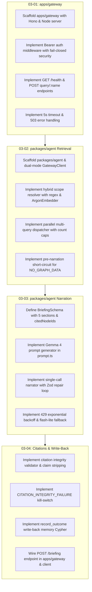

# Phase 3: Query Gateway & Briefing Pipeline - Research

**Date:** 2026-10-15  
**Milestone:** v1.0 MVP  
**Phase:** 03 — Query Gateway & Briefing Pipeline  
**Requirements:** GW-01, BRIEF-01, BRIEF-02, CITE-01, MEM-01  

---

## Executive Summary

Phase 3 implements Argon's core intelligence layer: bridging the FalkorDB knowledge graph (built in Phases 1 & 2) to downstream clients via a high-performance HTTP gateway service (`apps/gateway`) and an agent briefing pipeline (`packages/agent`).

The system adheres strictly to the project's founding thesis: **"no graph, no answer."** Rather than allowing an LLM to generate speculative Cypher or hallucinate architecture assertions, retrieval is 100% deterministic and parallelized across FalkorDB's `GRAPH.RO_QUERY` endpoints [VERIFIED: PRD §7.3, §11.1]. A single-call Gemma 4 narration model receives bounded, mathematically grounded evidence, generates structured output conforming to a 5-section Zod schema with explicit node ID citations, passes through a strict citation verification gate, and writes the resulting briefing back to FalkorDB as persistent memory [VERIFIED: 03-CONTEXT.md D-01 through D-16].

---

## 1. Locked Decisions & User Constraints

The following user decisions from [03-CONTEXT.md](file:///.planning/phases/03-query-gateway-briefing-pipeline/03-CONTEXT.md) are locked and govern all architectural plans:

| Decision ID | Area | Decision Summary | Source / Constraint |
|---|---|---|---|
| **D-01** | Gateway Routing | Granular named routes: `GET /health`, `POST /api/v1/:workspaceId/query/:queryName` for the 8 named queries, and `POST /api/v1/:workspaceId/briefing` for briefing synthesis. | [VERIFIED: 03-CONTEXT.md D-01] |
| **D-02** | Security & Auth | Bearer token auth via `Authorization: Bearer <GATEWAY_SECRET>`, failing closed (401 if missing or mismatched); `/health` remains public. | [VERIFIED: 03-CONTEXT.md D-02] |
| **D-03** | Timeout Policy | Strict 5-second per-query timeout returning HTTP 503 with structured codes `FALKORDB_TIMEOUT` or `FALKORDB_UNREACHABLE`. | [VERIFIED: 03-CONTEXT.md D-03] |
| **D-04** | Client Abstraction | Dual-mode `GatewayClient` in `packages/agent`: `HttpGatewayClient` (Next.js -> Cloud Run) and `DirectGraphGatewayClient` (in-process `packages/graph` queries for local dev, integration tests, and eval runner). | [VERIFIED: 03-CONTEXT.md D-04] |
| **D-05** | Scope Resolution | Hybrid scope resolver: regex and path heuristics detect explicit file paths and component names for `resolveScope`, while task text is embedded with `ArgonEmbedder` for `precedentSearch`. | [VERIFIED: 03-CONTEXT.md D-05] |
| **D-06** | Parallel Retrieval | Core parallel bundle: run `blastRadius`, `whoKnows`, `constrainingDecisions`, and `precedentSearch` concurrently with `Promise.allSettled`. | [VERIFIED: 03-CONTEXT.md D-06] |
| **D-07** | Vector Retrieval | Top 5 decisions with task prefix formatting (`task: search result \| query: ${text}`) and minimum cosine similarity cutoff (`>= 0.60`). | [VERIFIED: 03-CONTEXT.md D-07] |
| **D-08** | Evidence Caps | Hard count caps before prompt injection: max 15 touched files, max 5 blast-radius components, top 5 owners/reviewers, top 5 constraining decisions, top 3 precedent decisions. | [VERIFIED: 03-CONTEXT.md D-08] |
| **D-09** | Briefing Schema | Structured `BriefingSchema` with 5 typed sections (`summary`, `blastRadius`, `keyOwners`, `constrainingDecisions`, `precedents`) where each claim item explicitly includes `citedNodeIds: string[]`. | [VERIFIED: 03-CONTEXT.md D-09] |
| **D-10** | LLM & Repair Loop | Single narration call via `@ai-sdk/google` targeting `gemma-4-31b-it` (or `gemma-4-26b-a4b-it`) with an automated Zod repair loop (1 reprompt on schema error). | [VERIFIED: 03-CONTEXT.md D-10] |
| **D-11** | 429 Resilience | 2 exponential backoff retries (1s, 2s) on 429, followed by automatic fallback to `gemini-2.5-flash-lite`. | [VERIFIED: 03-CONTEXT.md D-11] |
| **D-12** | Short-Circuit | If parallel retrieval yields 0 files, 0 components, and 0 decisions, skip LLM call entirely and return status `"NO_GRAPH_DATA"`. | [VERIFIED: 03-CONTEXT.md D-12] |
| **D-13** | Citation Validation | In-memory set check + FalkorDB fallback: verify all `citedNodeIds` against retrieval evidence set; drop any claim items with unverified IDs. | [VERIFIED: 03-CONTEXT.md D-13] |
| **D-14** | Kill-Switch Refusal | If citation validation drops all claim items (0 verified citations remain), return status `"CITATION_INTEGRITY_FAILURE"`. | [VERIFIED: 03-CONTEXT.md D-14] |
| **D-15** | Memory Schema | Graph-native `(:Briefing)` node schema with `[:CITES]` edges to verified cited nodes and `[:ABOUT]` edges to touched components. | [VERIFIED: 03-CONTEXT.md D-15] |
| **D-16** | Attribution | Optional actor attribution on `(:Briefing)`: `actorId: contributorId ?? sessionId`, linking `(:Person)-[:REQUESTED]->(:Briefing)` if contributor selected. | [VERIFIED: 03-CONTEXT.md D-16] |

---

## 2. Requirement Traceability Matrix

| Requirement | Plan | Description | Status & Target Component |
|---|---|---|---|
| **GW-01** | 03-01 | Cloud Run gateway service exposes authenticated endpoints for the 8 named queries and communicates with FalkorDB over Direct VPC egress. | Pending -> `apps/gateway` (Hono application) |
| **BRIEF-01** | 03-02 | Backend executes relevant named queries in parallel to gather evidence for a requested scope. | Pending -> `packages/agent/src/briefing/dispatcher.ts` |
| **BRIEF-02** | 03-03 | Single-call Gemma 4 narration model synthesizes query results into a structured briefing JSON with strict Zod schema validation and auto-retry parser. | Pending -> `packages/agent/src/briefing/narrator.ts` |
| **CITE-01** | 03-04 | Citation enforcement post-check verifies that 100% of cited node IDs exist in the active graph before rendering. | Pending -> `packages/agent/src/citations/validator.ts` |
| **MEM-01** | 03-04 | Briefing outcomes are recorded back to the workspace graph as `(:Briefing)` nodes linked via `[:CITES]` and `[:ABOUT]`. | Pending -> `packages/agent/src/memory/record-outcome.ts` |

---

## 3. Plan-by-Plan Technical Analysis

### Plan 03-01: Gateway Service (`apps/gateway`)

#### 3.1 Framework Selection & Server Setup
- **Framework:** `hono` with `@hono/node-server` [VERIFIED: 03-CONTEXT.md].
- **Runtime:** Node.js v22 [VERIFIED: node v22.22.2 installed in container].
- **Port Handling:** Reads `process.env.PORT ?? 8080` (standard Cloud Run convention) [CITED: PRD §10.2].
- **Hono Native Testing:** Hono's `app.request(path, options)` enables complete HTTP route and middleware testing in Vitest without binding real TCP sockets [VERIFIED: Hono documentation].

#### 3.2 Endpoint Contracts

1. **`GET /health`** (Public)
   - Returns `{ status: 'ok', falkor: 'healthy' | 'unreachable', uptime: number, timestamp: number }`.
   - Calls `ArgonGraphClient.ping()` to report database connectivity.
   - Does NOT require Bearer token.

2. **`POST /api/v1/:workspaceId/query/:queryName`** (Authenticated)
   - Accepts URL parameter `:workspaceId` and `:queryName`.
   - Normalizes `:queryName` supporting both snake_case and camelCase:
     - `resolve_scope` / `resolveScope`
     - `blast_radius` / `blastRadius`
     - `risk_ranking` / `riskRanking`
     - `who_knows` / `whoKnows`
     - `constraining_decisions` / `constrainingDecisions`
     - `precedent_search` / `precedentSearch`
     - `path_between` / `pathBetween`
     - `component_overview` / `componentOverview`
   - Validates JSON body against the query's corresponding Zod schema in `packages/graph/src/queries/types.ts` (`ResolveScopeParamsSchema`, etc.).
   - Returns standard `DualPayload<T>` (`{ raw: T, graph: CytoscapeElements, evidence: { nodeCount, edgeCount, primaryIds } }`) [VERIFIED: packages/graph/src/queries/index.ts].
   - Returns HTTP 400 with `{ error: 'Validation Error', details: zodError.issues }` on bad payload.
   - Returns HTTP 404 for unknown query names.

3. **`POST /api/v1/:workspaceId/briefing`** (Authenticated)
   - Accepts `{ task: string, files?: string[], components?: string[], asOf?: number, contributorId?: string }`.
   - Coordinates parallel retrieval, narration, citation validation, and write-back memory.
   - Returns full `BriefingResponse` (`{ status, briefing, graph, verifiedCitationCount, briefingId }`).

#### 3.3 Security & Authentication
- **Fail-Closed Header Verification:**
  ```ts
  export function bearerAuthMiddleware(gatewaySecret: string | undefined) {
    return async (c: Context, next: Next) => {
      if (!gatewaySecret || gatewaySecret.trim() === '') {
        return c.json({ error: 'Server authentication unconfigured', code: 'AUTH_CONFIG_ERROR' }, 500);
      }
      const auth = c.req.header('Authorization');
      if (!auth || !auth.startsWith('Bearer ')) {
        return c.json({ error: 'Missing or malformed Authorization header', code: 'UNAUTHORIZED' }, 401);
      }
      const token = auth.slice(7).trim();
      if (token !== gatewaySecret) {
        return c.json({ error: 'Invalid Bearer token', code: 'UNAUTHORIZED' }, 401);
      }
      await next();
    };
  }
  ```
  [VERIFIED: 03-CONTEXT.md D-02].

#### 3.4 5-Second Timeout Enforcement
- Queries wrapped with strict 5000ms timeout [VERIFIED: 03-CONTEXT.md D-03].
- Catches FalkorDB timeouts or `FalkorUnavailableError` and maps to HTTP 503:
  ```json
  { "error": "FalkorDB query timed out after 5000ms", "code": "FALKORDB_TIMEOUT" }
  ```
  or
  ```json
  { "error": "FalkorDB is unreachable", "code": "FALKORDB_UNREACHABLE" }
  ```

---

### Plan 03-02: Parallel Retrieval Dispatcher (`packages/agent`)

#### 3.1 Dual-Mode Gateway Client Interface
The client abstraction enables identical query calling semantics whether running inside Next.js calling Cloud Run over HTTP, or running integration tests / eval backtests directly against FalkorDB:

```ts
export interface GatewayClient {
  executeQuery<K extends QueryName>(
    workspaceId: string,
    queryName: K,
    params: QueryParamsMap[K]
  ): Promise<DualPayload<QueryResultMap[K]>>;
  
  generateBriefing(
    workspaceId: string,
    request: BriefingRequest
  ): Promise<BriefingResponse>;
  
  healthCheck(): Promise<{ ok: boolean; [key: string]: unknown }>;
}
```
- **`HttpGatewayClient`:** Uses standard `fetch` with `Authorization: Bearer ${GATEWAY_SECRET}` and 5-10s timeout handling.
- **`DirectGraphGatewayClient`:** Executes queries directly via in-process `ArgonGraphClient` and `packages/graph` query functions.

#### 3.2 Hybrid Scope Resolver
When a user submits a natural-language task or code reference into the command bar:
1. **Explicit Entity Extraction (Regex Heuristics):**
   - File paths: matches patterns with standard file extensions (`\b[\w./-]+\.(?:ts|tsx|js|jsx|py|go|rs|md|json|cypher|yml|yaml|css|html)\b`) or directory-delimited paths.
   - Component names: detects explicit components or directory tokens.
   - Executes `resolveScope(client, workspaceId, { paths: detectedPaths, names: detectedComponents })` to retrieve existing `File` and `Component` nodes.
2. **Semantic Precedent Vectorization:**
   - Embeds raw task string using `ArgonEmbedder.embed(task, true)` with prefix `task: search result | query: ${task}` [VERIFIED: packages/graph/src/embedding/embedder.ts].
   - Output: 512-d normalized float vector for vector index retrieval.

#### 3.3 Concurrent Retrieval via `Promise.allSettled`
Once initial scope is resolved (or using detected files/components), dispatch the core retrieval bundle concurrently [VERIFIED: 03-CONTEXT.md D-06]:
```ts
const [blastResult, whoResult, constrainingResult, precedentResult] = await Promise.allSettled([
  client.executeQuery(workspaceId, 'blastRadius', { files: targetFiles, maxDepth: 3 }),
  client.executeQuery(workspaceId, 'whoKnows', { components: targetComponents }),
  client.executeQuery(workspaceId, 'constrainingDecisions', { files: targetFiles, asOf: request.asOf ?? Date.now() }),
  client.executeQuery(workspaceId, 'precedentSearch', { queryVector, limit: 5 }),
]);
```

#### 3.4 Precedent Filtering & Hard Count Caps
- **Vector Filter:** Filters precedent results where `score >= 0.60` [VERIFIED: 03-CONTEXT.md D-07].
- **Hard Caps Bound Context:**
  - Files: max 15
  - Blast-radius components: max 5
  - Owners/reviewers: top 5
  - Constraining decisions: top 5
  - Precedent decisions: top 3
  [VERIFIED: 03-CONTEXT.md D-08].

#### 3.5 Pre-Narration Short-Circuit
If after parallel retrieval:
- `files.length === 0` AND
- `components.length === 0` AND
- `decisions.length === 0`
Return immediately with:
```json
{
  "status": "NO_GRAPH_DATA",
  "briefing": null,
  "graph": { "nodes": [], "edges": [] },
  "message": "No matching graph entities found for the requested scope."
}
```
Skips LLM call completely, preventing speculation and preserving free-tier quotas [VERIFIED: 03-CONTEXT.md D-12].

---

### Plan 03-03: Gemma 4 Narration & Schema Enforcement

#### 4.1 Schema Definition (`BriefingSchema`)
Conforming to D-09, the schema contains 5 typed sections, where every claim item explicitly requires `citedNodeIds: string[]`:

```ts
export const ClaimItemSchema = z.object({
  claim: z.string().min(1),
  citedNodeIds: z.array(z.string()).min(1, 'Claims must cite at least one graph node ID'),
});

export const BriefingSchema = z.object({
  summary: z.object({
    overview: z.string().min(1),
    riskLevel: z.enum(['low', 'medium', 'high', 'critical']),
    keyTakeaways: z.array(ClaimItemSchema).min(1),
  }),
  blastRadius: z.object({
    analysis: z.string(),
    affectedComponents: z.array(
      z.object({
        component: z.string(),
        reason: z.string(),
        citedNodeIds: z.array(z.string()).min(1),
      })
    ),
  }),
  keyOwners: z.array(
    z.object({
      personId: z.string(),
      name: z.string(),
      component: z.string(),
      role: z.enum(['author', 'reviewer', 'expert']),
      authoredCount: z.number().default(0),
      reviewedCount: z.number().default(0),
      citedNodeIds: z.array(z.string()).min(1),
    })
  ),
  constrainingDecisions: z.array(
    z.object({
      decisionId: z.string(),
      title: z.string(),
      component: z.string(),
      status: z.string(),
      constraint: z.string(),
      citedNodeIds: z.array(z.string()).min(1),
    })
  ),
  precedents: z.array(
    z.object({
      decisionId: z.string(),
      title: z.string(),
      relevance: z.string(),
      similarityScore: z.number().optional(),
      citedNodeIds: z.array(z.string()).min(1),
    })
  ),
});
```

#### 4.2 LLM Invocation & Zod Repair Loop
- **Primary Model:** `gemma-4-31b-it` (or `gemma-4-26b-a4b-it`) via `@ai-sdk/google` [VERIFIED: search results; PRD §9.3].
- **API Key Resolution:** `process.env.GOOGLE_GENERATIVE_AI_API_KEY ?? process.env.GEMINI_API_KEY`.
- **System Prompt:** Lives in diffable markdown/template (`packages/agent/src/briefing/prompt.ts`) [VERIFIED: PRD §14.2].
  - Mandates that the model can ONLY cite IDs present in the `<EVIDENCE>` block.
  - Mandates strict JSON matching the schema.
- **Automated Repair Loop:**
  - If output fails `BriefingSchema.safeParse`:
  - Run 1 reprompt providing the model its previous raw response and the specific Zod validation errors [VERIFIED: 03-CONTEXT.md D-10].
  - Re-parse repaired response. If still invalid, throw structured `BriefingValidationError`.

#### 4.3 Rate Limit (HTTP 429) Resilience
- If the Google API returns HTTP 429 / resource exhausted:
  - Retry 1: wait 1000ms with exponential backoff.
  - Retry 2: wait 2000ms.
  - If 429 persists after 2 retries: automatically fallback to `gemini-2.5-flash-lite` via `@ai-sdk/google` [VERIFIED: 03-CONTEXT.md D-11].

---

### Plan 03-04: Citation Integrity Validator & Write-back Memory

#### 5.1 Citation Integrity Validator
To guarantee 100% citation validity ("no graph, no answer"):
1. **Evidence ID Universe Compilation:**
   Extract all canonical node IDs from the retrieval evidence bundle (`DualPayload.graph.nodes.map(n => n.data.id)` + `primaryIds`).
   This builds an in-memory `verifiedSet = new Set<string>()` containing all retrieved files, components, people, decisions, and PRs.
2. **Claim-by-Claim Verification:**
   Inspect all claim items across all 5 sections.
   For any `citedNodeId` in a claim:
   - If `verifiedSet.has(citedNodeId)` -> valid.
   - If not in `verifiedSet`, check FalkorDB fallback query:
     `MATCH (n) WHERE n.id = $id OR n.path = $id OR n.name = $id RETURN coalesce(n.id, n.path, n.name) AS foundId LIMIT 1`.
     If found in active graph -> add to `verifiedSet` as valid.
   - If still unverified: mark claim as ungrounded and **strip the claim item** from the briefing section [VERIFIED: 03-CONTEXT.md D-13].
3. **Refusal Kill-Switch:**
   Count total valid citations remaining across the entire briefing.
   If `verifiedCitationCount === 0` (or all claims stripped):
   Return status `"CITATION_INTEGRITY_FAILURE"` and refuse to present ungrounded assertions [VERIFIED: 03-CONTEXT.md D-14].

#### 5.2 Write-Back Memory (`record_outcome`)
When a valid briefing is produced, record it to the workspace graph in FalkorDB:
- **Node:** `(:Briefing)`
  - `id`: unique UUID
  - `task`: user task query string
  - `summary`: briefing overview text
  - `actorId`: `contributorId ?? sessionId`
  - `created_at`: epoch milliseconds timestamp
  - `scope_hash`: hash of input parameters
- **Edges:**
  - `(:Briefing)-[:CITES]->(target)` for each verified cited node (Decision, Component, File).
  - `(:Briefing)-[:ABOUT]->(c:Component)` for each affected component.
  - If `contributorId` is provided: `(:Person { id: contributorId })-[:REQUESTED]->(:Briefing)`.
- **Query Execution:** Written via `ArgonGraphClient.query()` (write query) [VERIFIED: 03-CONTEXT.md D-15, D-16].

---

## 4. Dependencies & Compatibility Gate

### 4.1 Dependency Roster

| Package | Version Range | Purpose | Target Workspace | Legitimacy Check |
|---|---|---|---|---|
| `hono` | `^4.7.0` | High-performance Web / Node HTTP framework | `apps/gateway` | Verified on npm (v4.13.x/4.23.x current) |
| `@hono/node-server` | `^1.13.0` | Node.js HTTP server adapter for Hono | `apps/gateway` | Verified on npm |
| `ai` | `^6.0.0` | Vercel AI SDK core | `packages/agent` | Verified on npm (v6.0.x is current major) |
| `@ai-sdk/google` | `^4.0.0` | Google Generative AI provider (Gemma 4, Gemini) | `packages/agent` | Verified on npm (v4.0.x compatible with AI SDK v6) |
| `zod` | `^3.24.2` | Schema validation | `apps/gateway`, `packages/agent` | Already in root lockfile (`3.25.76`) |
| `dotenv` | `^16.4.7` | Environment variables | `apps/gateway` | Already in root lockfile |

### 4.2 Workspace Configuration (`pnpm-workspace.yaml`)
`pnpm-workspace.yaml` already matches `apps/*` and `packages/*`. Adding `apps/gateway` and `packages/agent` requires zero root config adjustments.

---

## 5. Testing & Verification Architecture

### 5.1 Unit Tests (Offline / Mocked)
- **Gateway HTTP Tests (`apps/gateway/test/gateway.test.ts`):**
  - Verify `GET /health` is public and reports status.
  - Verify `POST /api/v1/:workspaceId/query/:queryName` rejects unauthenticated requests with 401.
  - Verify query dispatch calls graph functions with validated params.
  - Verify 5000ms query timeout maps to HTTP 503 (`FALKORDB_TIMEOUT`).
  - Uses Hono's `app.request()` — no live server or open port required.
- **Hybrid Resolver Tests (`packages/agent/test/resolver.test.ts`):**
  - Validates regex parsing of varied file extensions and directory components.
  - Validates embedding task prefix formatting.
- **Narration & Schema Repair Tests (`packages/agent/test/narrator.test.ts`):**
  - Validates Zod schema validation against mock Gemma 4 outputs.
  - Validates automated 1-step reprompting repair loop on invalid schema JSON.
  - Validates 429 exponential backoff and fallback model switching.
  - Validates pre-narration short-circuit on empty graph data (`NO_GRAPH_DATA`).
- **Citation Integrity Tests (`packages/agent/test/citation.test.ts`):**
  - Validates stripping of claim items containing unverified IDs.
  - Validates return of `CITATION_INTEGRITY_FAILURE` when all citations are stripped.
- **Write-Back Memory Tests (`packages/agent/test/memory.test.ts`):**
  - Validates Cypher query and parameter generation for `record_outcome`.

### 5.2 Integration Tests (FalkorDB Connected)
- `HttpGatewayClient` vs `DirectGraphGatewayClient` output equivalence against the seeded test graph.
- Real `record_outcome` write-back verification confirming `(:Briefing)` and `[:CITES]` edges exist in FalkorDB.

---

## 6. Common Pitfalls & Remediations

1. **Gemma 4 Free-Tier Quota Exhaustion:**
   - *Risk:* Multiple multi-step agent tool calls quickly deplete free-tier RPM/TPM limits.
   - *Remediation:* Enforce single-call narration with deterministic pre-retrieval; keep thinking disabled or low; hard cap evidence context; automated fallback to `gemini-2.5-flash-lite`.
2. **Missing `citedNodeIds` Hallucinations:**
   - *Risk:* Model cites valid-sounding component names or file paths that do not exist in the active graph.
   - *Remediation:* Strict two-tier citation check (in-memory evidence set + FalkorDB fallback) strips any unverified claim items; kill-switch refusal if 0 valid citations remain.
3. **Gateway Fail-Open Security Hole:**
   - *Risk:* If `GATEWAY_SECRET` is unset in Cloud Run environment, bearer token middleware might allow requests.
   - *Remediation:* Middleware fails closed: returns 500 `AUTH_CONFIG_ERROR` if `GATEWAY_SECRET` is undefined or empty string.
4. **FalkorDB Write Failure in Read Queries:**
   - *Risk:* Accidental mutation during query execution.
   - *Remediation:* All queries run strictly through `roQuery` (`GRAPH.RO_QUERY`), which physically rejects write statements at the engine level. `client.query` is strictly isolated to `record_outcome`.

---

## 7. Recommended Implementation Sequence



---

*Research document compiled conforming to all rules and constraints.*  
*Ready for Phase 3 plan authoring.*
