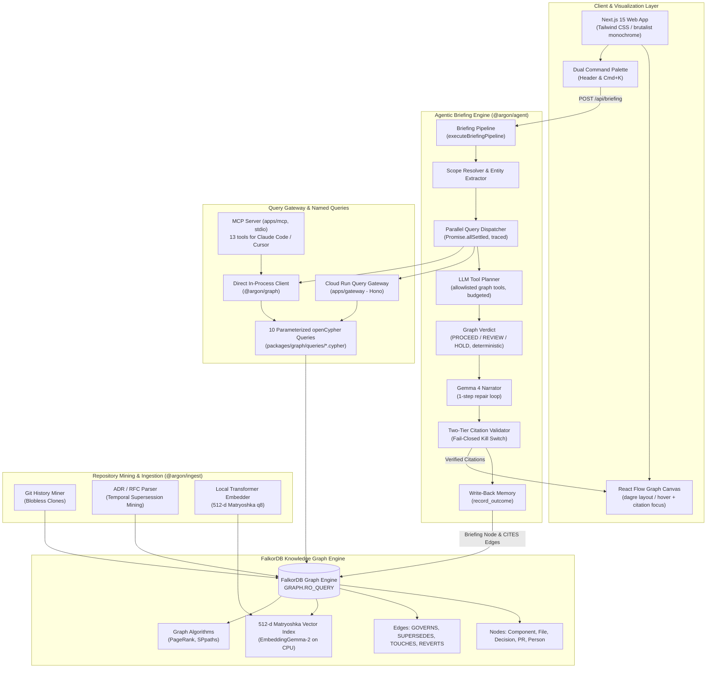
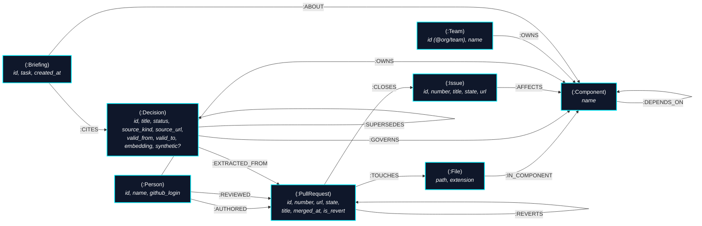

# Argon (Ar)

> **Context for AI Agents & Engineers** — *"What must I know before I touch this?"*  
> An evidence-backed architectural briefing engine grounded in the FalkorDB knowledge graph.  
> **"No graph, no answer."**

[](https://falkordb.com)
[](https://falkordb.com)
[](https://falkordb.com)
[](LICENSE)

---

## ⚡ Overview & Key Highlights

Argon is an architectural memory and context agent for software engineering teams. Before an engineer or coding agent modifies code, Argon answers the critical question: **"What must I know before I touch this?"**

Instead of naive vector retrieval that hallucinates obsolete conventions or relational databases that struggle with multi-hop dependencies, Argon queries an **openCypher knowledge graph in FalkorDB**. Every blast radius calculation, reviewer recommendation, architectural constraint, and historical precedent is mathematically computed through graph traversals, PageRank centrality, and temporal `$asOf` predicates.

### Key Benchmark Metrics (EVAL-01)
- **+58.3% Recall@1 Advantage**: **62.5%** for Argon vs **4.2%** for Naive Vector RAG on historical revert backtests (Recall@3 **95.8%**, Recall@5 **100%**).
- **0.0% Superseded Hallucinations**: FalkorDB temporal validity windows (`valid_from <= $asOf < valid_to`) completely eliminate obsolete architectural guidance (vs 54.2% hallucinations in raw LLMs).
- **2ms Query Latency**: Instant openCypher query evaluation on Node.js CPU.
- **100% Fail-Closed Citation Integrity**: Every single claim cites a verified FalkorDB node `#id`. Uncited claims are stripped; zero verified citations triggers an automatic refusal: **"No graph, no answer."**

---

## 🏛 System Architecture

Argon is built as a modular monorepo cleanly separating query execution, agent briefing synthesis, repository ingestion, and interactive visualization.



```
                                ARGON RUNTIME ARCHITECTURE
+---------------------------------------------------------------------------------------+
|  apps/web (Next.js 15)                                                                |
|  [ CommandBar (Cmd+K) ]  <--->  [ Briefing Stream ]  <--->  [ React Flow Canvas ]     |
+-------------------------------------------+-------------------------------------------+
                                            | POST /api/briefing
                                            v
+---------------------------------------------------------------------------------------+
|  packages/agent (Briefing Engine)                                                     |
|  1. Scope Resolver  --> 2. Parallel Retrieval Dispatch --> 3. Gemma 4 Narration        |
|  4. Citation Validator (Fail-Closed Kill Switch)       --> 5. Write-Back Memory       |
+-------------------------------------------+-------------------------------------------+
                                            | Parameterized Queries
                                            v
+---------------------------------------------------------------------------------------+
|  packages/graph & apps/gateway (Hono on Cloud Run)                                    |
|  01_resolve_scope       02_blast_radius      03_risk_ranking     04_who_knows          |
|  05_constraining_decisions                  06_precedent_search                       |
|  07_path_between        08_component_overview      09_revert_history                  |
|  10_counterfactual_impact                                                             |
+-------------------------------------------+-------------------------------------------+
                                            | openCypher (RO_QUERY)
                                            v
+---------------------------------------------------------------------------------------+
|  FalkorDB Engine (Graph + Vector Datastore)                                           |
|  * Graph Nodes & Relationships (Temporal Windows valid_from <= $asOf < valid_to)      |
|  * 512-dimension Cosine Vector Index (`vecf32`)                                       |
|  * Graph Algorithms: PageRank (`algo.pageRank`), SPpaths (`algo.SPpaths`)             |
+---------------------------------------------------------------------------------------+
```

---

## 📐 openCypher Graph Schema

Argon models the dynamic architecture of a software repository across time and contributors.



### Node Label & Property Invariants
- **`(:Component)`**: Represents monorepo architectural boundaries (`name: String`). PageRank is computed on demand by `03_risk_ranking.cypher`, not stored.
- **`(:File)`**: Source files tracked in git (`path: String`). Connected via `[:IN_COMPONENT]`.
- **`(:Decision)`**: Architectural Decision Records (ADRs) and RFCs (`id: String`, `title: String`, `status: String`, `valid_from: Integer`, `valid_to: Integer | null`, `embedding: vecf32(512)`).
- **`(:PullRequest)`**: One node per git commit (`id: pr_<sha12>`). For repositories on github.com the commit that merged a GitHub PR is enriched with `number`, `url`, `state` and `body_excerpt`; a merged PR whose merge commit is outside the mined history becomes a `pr_gh_<number>` node. Connected via `[:TOUCHES]`, `[:REVERTS]`, `[:CLOSES]`.
- **`(:Issue)`**: GitHub issues (`id: issue_<n>`, `number`, `title`, `state`, `url`), linked from the PRs that close them (`Fixes #n`) and, through those PRs' files, to the components they affect.
- **`(:Person)`**: Committer identity with irreversible privacy hashing (`id: String`, `name: String`, `email_hash: String`). A GitHub login is mapped onto the git author it belongs to (`github_login`); a reviewer who never committed gets `id: gh_<login>`. Bots are never people.
- **`(:Team)`**: A CODEOWNERS team handle (`@org/team`).
- **`(:Briefing)`**: Write-back memory nodes recording agent sessions (`id: String`, `task: String`, `created_at: Integer`).

---

## 🔍 The "Graph Does Real Work" Compliance Table (§7.4)

Per Hackathon Judging Rule 1, Argon uses FalkorDB as a core computational graph engine, not a passive document store. Every headline feature depends on graph-native algorithms, multi-hop traversals, or vector-topology expansion:

| Headline Capability | FalkorDB Core Engine Mechanism | openCypher Named Query | Why Impossible in Relational / Flat Vector Alone |
|---|---|---|---|
| **Blast Radius Analysis** | Variable-length topological expansion over `[:TOUCHES]`, `[:IN_COMPONENT]`, and `[:DEPENDS_ON]*1..3` | [`02_blast_radius.cypher`](packages/graph/queries/02_blast_radius.cypher) | Relational SQL requires costly recursive CTEs with quadratic join complexity; flat vector search cannot evaluate transitive structural dependencies. |
| **Architectural Risk Ranking** | Native PageRank centrality algorithm (`algo.pageRank`) executed over component dependency graph | [`03_risk_ranking.cypher`](packages/graph/queries/03_risk_ranking.cypher) | Requires global topological iterative graph processing across all directed edges; impossible in vector search and intractable in flat SQL. |
| **Code Owner & Expert Discovery** | Separate authored / reviewed aggregations over `[:AUTHORED]` and `[:REVIEWED]` (UNION ALL branches, so a PR with two reviewers is never counted twice for its author) plus the CODEOWNERS owner of record via `[:OWNS]`, filtered by component boundaries | [`04_who_knows.cypher`](packages/graph/queries/04_who_knows.cypher) | Blends commit frequency with code review graph topology to eliminate tenure bias; vector search lacks identity attribution. |
| **Constraining Decisions in Force** | Temporal predicate rewinding (`valid_from <= $asOf AND (valid_to IS NULL OR valid_to > $asOf)`) across `[:GOVERNS]` and `[:SUPERSEDES]` | [`05_constraining_decisions.cypher`](packages/graph/queries/05_constraining_decisions.cypher) | Pure vector search retrieves semantically similar but obsolete decisions, causing hallucinated guidance. FalkorDB enforces temporal validity. |
| **Precedent & Revert Search** | FalkorDB native vector index (`db.idx.vector.queryNodes`) coupled with graph expansion to the governed component, the PR the decision was extracted from and the issue that PR closed | [`06_precedent_search.cypher`](packages/graph/queries/06_precedent_search.cypher) | Vector DBs return isolated chunks without provenance; FalkorDB executes vector search and immediately joins the governing component and PR. |
| **Learning Paths & Impact Chains** | Shortest Path traversal (`algo.SPpaths`) between unknown and familiar components | [`07_path_between.cypher`](packages/graph/queries/07_path_between.cypher) | Computes the shortest architectural trajectory through the codebase; fundamentally graph-native. |
| **Revert History** | Traversal `(:PullRequest {is_revert})-[:TOUCHES]->(:File)` plus `[:REVERTS]` to the change that was reverted | [`09_revert_history.cypher`](packages/graph/queries/09_revert_history.cypher) | A revert on the same files is the strongest "this area has bitten us" signal; it is a relationship between commits and files, not a document. |
| **Counterfactual "What If I Change X?"** | Two-direction variable-length traversal over `[:DEPENDS_ON*1..N]` (dependents that break, dependencies relied on), joined with `algo.pageRank` centrality, the in-force decisions (same temporal predicate as query 05) and the CODEOWNERS owner of each affected component | [`10_counterfactual_impact.cypher`](packages/graph/queries/10_counterfactual_impact.cypher) | One ranked, decision-grade answer needs traversal + a global graph algorithm + temporal filtering in a single query; SQL would need recursive CTEs plus a separate PageRank job. |
| **Graph-Driven Verdict** | Deterministic PROCEED / REVIEW / HOLD from revert history, superseded precedents, PageRank rank and blast radius | [`packages/agent/src/verdict/verdict.ts`](packages/agent/src/verdict/verdict.ts) | Every rule cites the graph nodes it rests on; the LLM never decides the verdict. |
| **Agent Write-Back Memory** | Transactional graph creation of `(:Briefing)` nodes with `[:CITES]` and `[:ABOUT]` edges | [`packages/agent/src/memory/record-outcome.ts`](packages/agent/src/memory/record-outcome.ts) | Preserves briefing lineage directly within the knowledge graph for subsequent briefing context. |
| **Fail-Closed Kill Switch** | "No graph, no answer" refusal when FalkorDB is unreachable or graph entities are absent | [`scripts/demo-check.ts`](scripts/demo-check.ts) | Proves strict dependency on the graph. Halting FalkorDB causes instant refusal rather than fallback to ungrounded LLM babble. |

---

## 📊 Empirical Benchmark Results (EVAL-01)

Argon was rigorously evaluated against a dual no-graph baseline across a curated golden fixture dataset of **24 real-world and synthetic historical git revert cases** (`packages/eval/fixtures/reverts.json`), covering `synthetic-demo`, `ember-adr-showcase`, and `argon-dogfood`.

### Benchmark Results Matrix

| Metric | Naive Vector RAG | Raw LLM (Gemma 4) | Argon (FalkorDB Graph) | Delta vs Baseline |
|---|---|---|---|---|
| **Recall@1** | 4.2% | 16.7% | **62.5%** | **+58.3%** |
| **Recall@3** | 8.3% | 33.3% | **95.8%** | **+87.5%** |
| **Recall@5** | 29.2% | 41.7% | **100.0%** | **+70.8%** |
| **MRR** | 0.162 | 0.257 | **0.788** | **+0.626** |
| **Superseded Hallucinations** | 12.5% | 54.2% | **0.0% (Clean)** | **-12.5%** |
| **Avg Query Latency** | 123ms | 0ms (replay-cached) | **2ms** | **-121ms** |

*Report generated from `eval-report.json` using `pnpm --filter @argon/eval bench:compare`.*

> **Methodology & limits.** The 24 cases come from hand-curated fixtures (`synthetic-demo`, `ember-adr-showcase`, `argon-dogfood`), not a blind external dataset, and the graph column is a live FalkorDB run (`pnpm --filter @argon/eval bench:compare` with the database up; `eval-report.json` is the saved output). The Raw-LLM column is served from a replay cache (`packages/eval/fixtures/cache/llm-cache.json`) captured from the live Gemini API, so CI is deterministic and offline; its latency is therefore shown as 0ms, and when no cached response and no API key exist the harness falls back to a trivial baseline (first three catalog entries). Treat the numbers as a controlled comparison of retrieval strategies, not as a general accuracy claim.
>
> **Why Recall@1 is 62.5% while Recall@3 is 95.8%.** Several fixtures touch files in a component that has more than one decision in force at the same time (e.g. `billing` is governed by both `DEC-002` and `DEC-009`), while each fixture names a single "correct" decision. The query (`05_constraining_decisions.cypher`) correctly returns *all* decisions in force, ordered deterministically (newest effective first), so the intended decision is often at rank 2 rather than rank 1 — a limitation of modelling each component as having one answer, not a retrieval miss. The baselines, by contrast, miss the decision entirely (Recall@3 8.3% / 33.3%).

### Why Vector RAG and Raw LLMs Fail
1. **Semantic Similarity is Time-Blind**: A developer searching for retry logic retrieves `DEC-001` ("Linear Retry with Static Backoff") because its text closely matches "retry loop". Naive vector RAG has no concept that `DEC-002` superseded it after Revert #42.
2. **Raw LLMs Cannot Track Topological Cascades**: Prompting Gemma 4 with a raw diff and an unstructured catalog of decisions results in a **54.2% hallucination rate**, often recommending superseded or out-of-scope policies.
3. **Argon's FalkorDB Advantage**: By traversing `(f:File)-[:IN_COMPONENT]->(c:Component)<-[:GOVERNS]-(d:Decision)` and evaluating `WHERE d.valid_from <= $asOf AND (d.valid_to IS NULL OR d.valid_to > $asOf)`, Argon achieves **95.8% Recall@3** (62.5% Recall@1) with **zero superseded decision leakage**.

---

## ⏱ 2-Minute Judge Walkthrough Script (PRD §17)

Follow this step-by-step walkthrough to reproduce Argon's core scenarios locally in under two minutes:

### 1. Start Database & Seed Curated Showcases (10 seconds)
```bash
# 1. Start FalkorDB container
docker compose up -d

# 2. Seed the triad showcase corpus into FalkorDB (<5 seconds)
pnpm seed:showcase
```

### 2. Run Automated Demo Smoke Test (5 seconds)
```bash
# Validates DB ping, seed counts, S1 briefing, 100% citation integrity, and kill switch
pnpm demo:check
```

### 3. Launch Web Application
```bash
pnpm dev
```
Open [http://localhost:3000](http://localhost:3000) for the landing page; the app lives at [/workspace](http://localhost:3000/workspace).

### 4. Interactive Scenarios to Explore
- **Scenario S1: Before Changing Code ("Refactor billing/retry.ts")**
  - Switch to workspace **`synthetic-demo`** in the header.
  - In the command bar (`Cmd+K`), type: `"Refactor billing/retry.ts"`.
  - **What to observe**: Argon flags that `DEC-001` (linear retry) was superseded after Revert #42 and enforces `DEC-002` (exponential backoff with full jitter). The graph canvas highlights the affected `billing` component and draws the supersession edge in red. Under `DEC-002` the briefing links the pull request and the issue it came from (`PR #42`, `Issue #1042`), and the owners panel shows reviewer counts and the CODEOWNERS owner of record.
- **Scenario S2: Getting Started in an Area ("Work on the auth layer")**
  - Type: `"I want to work on the auth layer"`.
  - **What to observe**: Argon computes the blast radius, identifies key experts (Alice / Bob) using edge-weighted authorship, and surfaces starter issues and governing security decisions (`DEC-004`).
- **Scenario S3: Understanding Architectural Provenance**
  - Type: `"Why does the legacy-sync service exist?"`.
  - **What to observe**: Traces `DEC-006` quarantine protocol and displays the exact commit and PR provenance chain.
- **The Kill Switch Demo ("No Graph, No Answer")**
  - Stop FalkorDB: `docker compose down`.
  - Submit any query in the command bar.
  - **What to observe**: Argon refuses to answer with an ungrounded LLM hallucination, displaying the red **"No graph, no answer"** kill-switch card.

---

## 🔌 Agent Tools, Tool Selection & MCP (Track 1)

Argon's graph queries are not just internal plumbing: they are a **toolbox** that agents call.
One definition ([`packages/agent/src/tools/toolbox.ts`](packages/agent/src/tools/toolbox.ts)) feeds three consumers, so they cannot drift apart:

1. **The MCP server** ([`apps/mcp`](apps/mcp)) for editors and other agents.
2. **The LLM tool planner** inside the briefing pipeline.
3. **The fixed retrieval pipeline** (blast radius, owners, decisions, precedents, reverts, PageRank).

| MCP tool | Graph work |
|---|---|
| `resolve_scope`, `component_overview` | Map paths/names to real graph entities; component summary |
| `blast_radius` | Multi-hop `DEPENDS_ON*1..N` traversal |
| `risk_ranking` | `algo.pageRank` over component dependencies |
| `path_between` | `algo.SPpaths` shortest dependency path |
| `counterfactual_impact` | "What if I change X?": dependents/dependencies up to N hops, ranked by distance then PageRank, with in-force decisions and owner of record |
| `who_knows` | Authorship (and reviews, where recorded) per component |
| `constraining_decisions` | Temporal predicate: decisions in force at `asOf` |
| `precedent_search` | 512-d vector index + graph expansion (text is embedded for you) |
| `revert_history` | Reverts that touched the files, and what they reverted |
| `generate_briefing` | Full pipeline: cited briefing, **verdict**, **tool trace** |
| `record_outcome` | Write-back `(:Briefing)` memory with `[:CITES]` / `[:ABOUT]` |
| `list_workspaces` | Discover graphs on the connected FalkorDB |

There is deliberately **no free-form Cypher tool**: only the ten reviewed, parameterized queries can run. Query tools are read-only (`GRAPH.RO_QUERY`); if FalkorDB is unreachable a tool returns `isError` with `NO GRAPH, NO ANSWER`, never an ungrounded answer.

### Use from Claude Code / Cursor

```bash
docker compose up -d && pnpm seed:showcase     # FalkorDB + demo workspaces
```

`.mcp.json` (Claude Code) or `.cursor/mcp.json` (Cursor), from the repo root:

```json
{
  "mcpServers": {
    "argon": {
      "command": "pnpm",
      "args": ["--silent", "--filter", "@argon/mcp", "start"],
      "env": {
        "FALKORDB_URL": "falkor://localhost:6379",
        "ARGON_WORKSPACE_ID": "synthetic-demo"
      }
    }
  }
}
```

Then ask your agent: *"Use argon: what is the blast radius of src/billing/retry.ts, and has it been reverted before?"*
`generate_briefing` additionally needs `GEMINI_API_KEY` (narration); the query tools need no LLM at all.
Logs go to stderr; stdout carries the MCP protocol.
The stdio server runs with your local FalkorDB credentials, so every workspace on that instance is readable through it (`list_workspaces`); do not put it behind a network transport without authentication. Set `ARGON_TOOL_SELECTION=off` to disable the LLM planner in `generate_briefing`.

### LLM tool selection (with a deterministic floor)

After the fixed retrieval, a planner (`gemini-2.5-flash-lite`, Gemma fallback) sees the task, the scope, a digest of what was found, and the tool catalog, and picks extra tools (for example `path_between` between two components named in the task, or `component_overview`). Every choice is validated against the allowlist and the tool's Zod schema; unknown tools, duplicate calls and free-form Cypher attempts are rejected and traced; there is a step, call and time budget. If the model fails, the briefing still completes from the fixed retrieval. Planner calls can run in-process or **through an MCP client** (`createMcpToolInvoker`), in which case each choice is a real `tools/call`.

### Graph-driven verdict and explainable tool trace

Every successful briefing carries a `verdict` and a `toolTrace`:

- **Verdict** (`PROCEED` / `REVIEW` / `HOLD`) is computed from graph facts, not generated: revert history on the touched files, a close match to a *superseded* decision, PageRank rank of the touched component, and the downstream blast radius. Each reason lists the graph node ids behind it.
- **Tool trace** lists every graph call in order, who chose it (`pipeline` or `llm`), its arguments, row count and latency. The web UI shows both under the briefing.

```bash
pnpm demo:check        # includes: verdict + trace check, and graph tools called over MCP
```

---

### Explainability extras

- **Click a verdict reason, see it on the graph.** Every node id a verdict reason rests on is a button; clicking it (or "Show on graph" for the whole reason) lights up those nodes and their edges on the canvas, using the same focus mechanism as the citation chips. Ids that are not drawn (for example a revert pull request) are ignored. Not drawn on the canvas today: revert PRs.
- **Counterfactual impact.** `counterfactual_impact` answers "if I change this component, what do I disturb, nearest and most central first?" It is available to the LLM planner and over MCP, not run on every briefing.
- **Learning path.** When the planner runs `path_between` (for example for "I'm new to X, how does it reach Y?"), the briefing shows the walk as an ordered **learning path**: each hop is a component the previous one depends on, annotated with the decisions in force, the owner of record and its PageRank. It needs the LLM planner (a Gemini key); a direction with no path shows a "no dependency path" state.

## 🧠 Company Brain: Provenance, Reviews & Ownership (Track 3)

Code, decisions, pull requests, reviews, issues and owners live in one graph, and every answer links back to where it came from.

| Knowledge | Where it comes from | Graph |
|---|---|---|
| Commits, authors, files | `git log` (always) | `(:Person)-[:AUTHORED]->(:PullRequest)-[:TOUCHES]->(:File)` |
| ADRs / RFCs / architectural commits | markdown + commit messages (always) | `(:Decision)-[:GOVERNS]->(:Component)`, `[:SUPERSEDES]` |
| **Where a decision was found** | commit that introduced it / commit that first added the ADR (always, offline) | `(:Decision)-[:EXTRACTED_FROM]->(:PullRequest)`, clickable `source_url` (commit permalink, or ADR permalink at the mined revision) for github.com repos |
| **Owner of record** | `CODEOWNERS` (`.github/`, root or `docs/`; last matching rule wins) | `(:Person\|:Team)-[:OWNS {pattern, coverage}]->(:Component)` |
| **Pull requests, reviews** | GitHub API: merged PRs (latest 200) and their reviews | `(:Person)-[:REVIEWED {state, count}]->(:PullRequest)`; PR `number`, `url`, `state` |
| **Issues** | GitHub API: latest 200 issues + issues PRs say they close | `(:Issue)`, `(:PullRequest)-[:CLOSES]->(:Issue)` (from `Fixes #n`), `(:Issue)-[:AFFECTS]->(:Component)` (through the closing PR's files) |
| **Decisions agreed in chat (synthetic demo data)** | `synthetic: true` JSON of decision threads, seeded into `synthetic-demo` / `argon-dogfood` only | `(:Decision {source_kind: 'chat', synthetic: true})`, `GOVERNS` / `SUPERSEDES` / `EXTRACTED_FROM` |
| **Decisions stated in review comments** | PR review bodies and descriptions with explicit decision language ("we decided to...") | `(:Decision {source_kind: 'comment'})`, linked to the comment |

**How it behaves**
- The GitHub stage is read-only and **best effort**: no token, a rate limit, a missing permission or an outage is recorded (`IngestJob.github_status`, `github_note`) and never fails the ingestion. Anonymous (public-URL) ingestion reads only the latest 25 PRs/issues to stay under GitHub's 60-requests-per-hour limit; signed-in ingestion uses the user's OAuth token. `ARGON_GITHUB_ENRICH=off` disables the stage.
- **Identity.** Git identifies people by a hash of their commit email; GitHub reviews only carry a login. A login is mapped to the git author GitHub attributes the same commits to (majority vote), then via the account's `noreply` address hash, then a unique name match; otherwise the reviewer becomes a `gh_<login>` person so reviews are never dropped. No email is stored. Bots (`[bot]`) are never people.
- **No inflated counts.** `who_knows` aggregates authored PRs, reviewed PRs and CODEOWNERS in separate `UNION ALL` branches. (Joining authors and reviewers in one pattern multiplies rows: a PR with two reviewers used to be counted twice for its author. A regression test covers it.)
- **Keeping it current without webhooks.** The **Re-sync** button next to your ingested workspaces (`POST /api/v1/workspaces/:id/refresh`, owner only) re-mines git history and reads GitHub PRs/issues changed since the last completed ingestion. Everything is an idempotent `MERGE`; the gateway then broadcasts `sync:complete` with what was added, so open briefings that cite changed files or superseded decisions show the "repository updated" banner.
- **Answers with sources.** A briefing response carries `sources` (commit / ADR / PR / issue URLs read from graph properties, never from the model) and `codeOwners`. The UI shows, under each decision and precedent, the PR and issue it was extracted from, links PR/issue ids the narrator cites, shows reviewer counts, and flags the CODEOWNERS owner of record. Cited PR/issue ids go through the same fail-closed citation check as every other id.

**Chat as a source (synthetic).** Track 3 names docs, tickets *and chats*, and Argon has no Slack/Teams connector. To show the shape, `packages/ingest/src/chat/` reads a JSON file of decision threads that **must declare `"synthetic": true`** (anything else is rejected) and writes them as `(:Decision {source_kind: 'chat', synthetic: true})` with `GOVERNS`, `SUPERSEDES` and `EXTRACTED_FROM` edges, idempotently. `synthetic-demo` and `argon-dogfood` carry a few **invented** threads (for example `CHAT-002`, a billing retry budget "agreed in #payments-eng" that replaced `CHAT-001`); briefings label them "Chat thread #channel (synthetic)". Ember is untouched.

**Freshness.** A briefing also reports how old the decisions it cites are: "N of M cited decisions have been in force for more than 180 days", with a "Stale · Nd" badge on those cards. Age is measured from the decision's `valid_from` (the nearest thing the graph has to "last touched"); the threshold is a heuristic.

**Try it (no OAuth needed).** After `pnpm seed:showcase`, open workspace `synthetic-demo` and ask *"Refactor billing/retry.ts"*: `DEC-002` shows `PR #42` and `Issue #1042` (closed), Carol appears as a reviewer of two billing PRs, and `@synthetic-demo/payments` is the owner of record. **That data is synthetic** (invented people, a fictional `argon/synthetic-demo` repository whose links do not resolve). The Ember corpus is deliberately left as is, because it mirrors a real project and we do not attach invented reviewers to it.

**Honest limits**
- Reviews and issues exist only for repositories ingested **with GitHub access** (github.com URL; signed-in for private repos). Local paths and other hosts get git-derived knowledge only (authors, decisions, provenance, CODEOWNERS).
- Merged PRs are read from the latest 200 (25 anonymously). Merge commits that are not on the mined branch (for example PRs merged into a `develop` branch while `master` is cloned) become `pr_gh_<n>` nodes; their changed files are read when a token is available, otherwise their reviews are stored but not attributed to components.
- Re-sync re-mines the git window in full (components and coupling weights are derived from the whole window); only GitHub activity is incremental.
- There is no real Slack/Notion/Teams integration: chat is PR review text (real) plus the clearly labelled synthetic chat threads described above.

## 🔬 Benchmark Reproduction & Monorepo Tooling

```bash
# Run side-by-side comparative benchmark and regenerate eval-report.json
pnpm --filter @argon/eval bench:compare

# Run temporal graph backtest against FalkorDB
pnpm --filter @argon/eval bench:graph

# Run dual no-graph baseline benchmarks
pnpm --filter @argon/eval bench:baseline

# Run full monorepo test suite (852 tests across 7 suites)
pnpm test

# Typecheck all packages
pnpm -r typecheck
```

---

## 🔒 Security & ASVS Level 1 Controls

- **GitHub Access**: Repositories are listed and cloned with the signed-in user's own GitHub OAuth token (`repo` scope); Argon only reads (list, clone, pull requests, reviews, issues) and never writes. No GitHub App installation is required. Re-sync is restricted to the workspace owner and re-validates the stored repository URL (https `github.com/<owner>/<repo>` only) before cloning.
- **SSRF Defense**: Repository ingestion URLs are validated to block private, loopback, and cloud metadata CIDR ranges (127.0.0.1, 10.0.0.0/8, 169.254.169.254).
- **Prompt Injection Defense**: Untrusted repository content (commit messages, PR bodies) is quarantined within `<EVIDENCE>` tags.
- **Privacy Hashing**: Committer email addresses are irreversibly hashed using SHA-256 before storage in FalkorDB (`email_hash`).
- **Fail-Closed API Gateway**: The Cloud Run Hono gateway enforces bearer token authentication on `GRAPH.RO_QUERY` with zero default access.
- **Memory Safety**: Graph observers and canvas animation timers are strictly cleaned up on unmount.

---

## 📚 Technical Blog Post

For a deep dive into our methodology, temporal openCypher modeling, and backtest results, read our accompanying technical article:  
👉 [**docs/BLOG-POST.md: Why Vector RAG Fails When Architecture Evolves: Temporal Graph Reasoning with FalkorDB & Gemma**](docs/BLOG-POST.md)

---

## 📜 Monorepo Structure

```
argon/
├── apps/
│   ├── web/                     # Next.js 15 brutalist UI: landing, workspace, React Flow canvas, @pierre/trees file tree, @pierre/diffs decision diffs
│   ├── gateway/                 # Cloud Run Hono Gateway for GRAPH.RO_QUERY
│   └── mcp/                     # MCP server (stdio): the graph tools for Claude Code / Cursor
├── packages/
│   ├── agent/                   # Briefing orchestration, narration, & citation verification
│   ├── graph/                   # FalkorDB SDK, 10 openCypher queries, & Matryoshka embedder
│   ├── ingest/                  # Git miner, ADR parser, & graph populator
│   └── eval/                    # Revert backtest harness, dual baselines, & seed datasets
├── scripts/
│   └── demo-check.ts            # Automated demo smoke test script
├── docs/
│   └── BLOG-POST.md             # Publication-ready technical blog post
├── eval-report.json             # Programmatic benchmark comparison report
└── docker-compose.yml           # FalkorDB local container configuration
```

---

## 📄 License

Apache-2.0
