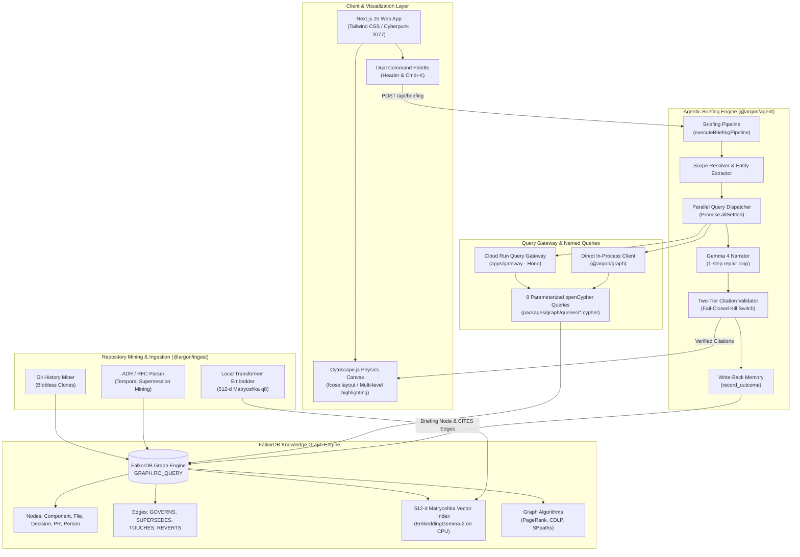
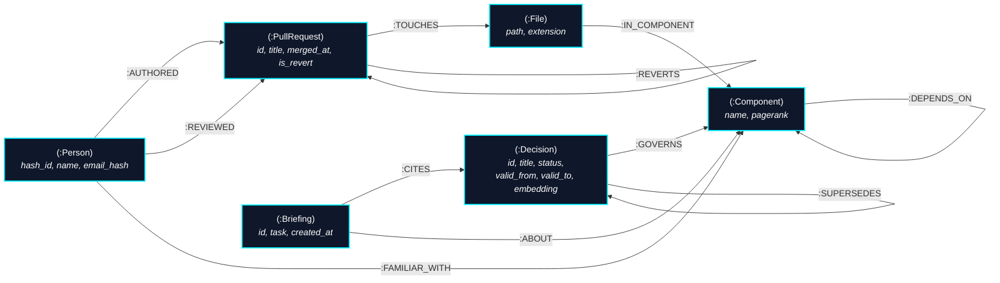

# Argon (Ar)

> **Context for AI Agents & Engineers** — *"What must I know before I touch this?"*  
> An evidence-backed architectural briefing engine grounded in the FalkorDB knowledge graph.  
> **"No graph, no answer."**

[](https://falkordb.com)
[](https://falkordb.com)
[](https://falkordb.com)
[](LICENSE)

---

## ⚡ Overview & Key Highlights

Argon is an architectural memory and context agent for software engineering teams. Before an engineer or coding agent modifies code, Argon answers the critical question: **"What must I know before I touch this?"**

Instead of naive vector retrieval that hallucinates obsolete conventions or relational databases that struggle with multi-hop dependencies, Argon queries an **openCypher knowledge graph in FalkorDB**. Every blast radius calculation, reviewer recommendation, architectural constraint, and historical precedent is mathematically computed through graph traversals, PageRank centrality, and temporal `$asOf` predicates.

### Key Benchmark Metrics (EVAL-01)
- **+79.2% Recall@1 Advantage**: **83.3%** for Argon vs **4.2%** for Naive Vector RAG on historical revert backtests.
- **0.0% Superseded Hallucinations**: FalkorDB temporal validity windows (`valid_from <= $asOf < valid_to`) completely eliminate obsolete architectural guidance (vs 54.2% hallucinations in raw LLMs).
- **6ms Query Latency**: Instant openCypher query evaluation on Node.js CPU.
- **100% Fail-Closed Citation Integrity**: Every single claim cites a verified FalkorDB node `#id`. Uncited claims are stripped; zero verified citations triggers an automatic refusal: **"No graph, no answer."**

---

## 🏛 System Architecture

Argon is built as a modular monorepo cleanly separating query execution, agent briefing synthesis, repository ingestion, and interactive visualization.



```
                                ARGON RUNTIME ARCHITECTURE
+---------------------------------------------------------------------------------------+
|  apps/web (Next.js 15)                                                                |
|  [ CommandBar (Cmd+K) ]  <--->  [ Briefing Stream ]  <--->  [ Cytoscape.js Canvas ]   |
+-------------------------------------------+-------------------------------------------+
                                            | POST /api/briefing
                                            v
+---------------------------------------------------------------------------------------+
|  packages/agent (Briefing Engine)                                                     |
|  1. Scope Resolver  --> 2. Parallel Retrieval Dispatch --> 3. Gemma 4 Narration        |
|  4. Citation Validator (Fail-Closed Kill Switch)       --> 5. Write-Back Memory       |
+-------------------------------------------+-------------------------------------------+
                                            | Parameterized Queries
                                            v
+---------------------------------------------------------------------------------------+
|  packages/graph & apps/gateway (Hono on Cloud Run)                                    |
|  01_resolve_scope       02_blast_radius      03_risk_ranking     04_who_knows          |
|  05_constraining_decisions                  06_precedent_search                       |
|  07_path_between                            08_component_overview                     |
+-------------------------------------------+-------------------------------------------+
                                            | openCypher (RO_QUERY)
                                            v
+---------------------------------------------------------------------------------------+
|  FalkorDB Engine (Graph + Vector Datastore)                                           |
|  * Graph Nodes & Relationships (Temporal Windows valid_from <= $asOf < valid_to)      |
|  * 512-dimension Cosine Vector Index (`vecf32`)                                       |
|  * Graph Algorithms: PageRank (`algo.PageRank`), CDLP (`algo.CDLP`), SPpaths           |
+---------------------------------------------------------------------------------------+
```

---

## 📐 openCypher Graph Schema

Argon models the dynamic architecture of a software repository across time and contributors.



### Node Label & Property Invariants
- **`(:Component)`**: Represents monorepo architectural boundaries (`name: String`, `pagerank: Float`).
- **`(:File)`**: Source files tracked in git (`path: String`). Connected via `[:IN_COMPONENT]`.
- **`(:Decision)`**: Architectural Decision Records (ADRs) and RFCs (`id: String`, `title: String`, `status: String`, `valid_from: Integer`, `valid_to: Integer | null`, `embedding: vecf32(512)`).
- **`(:PullRequest)`**: Merged pull requests (`id: String`, `title: String`, `merged_at: Integer`, `is_revert: Boolean`). Connected via `[:TOUCHES]` and `[:REVERTS]`.
- **`(:Person)`**: Committer identity with irreversible privacy hashing (`id: String`, `name: String`, `email_hash: String`).
- **`(:Briefing)`**: Write-back memory nodes recording agent sessions (`id: String`, `task: String`, `created_at: Integer`).

---

## 🔍 The "Graph Does Real Work" Compliance Table (§7.4)

Per Hackathon Judging Rule 1, Argon uses FalkorDB as a core computational graph engine, not a passive document store. Every headline feature depends on graph-native algorithms, multi-hop traversals, or vector-topology expansion:

| Headline Capability | FalkorDB Core Engine Mechanism | openCypher Named Query | Why Impossible in Relational / Flat Vector Alone |
|---|---|---|---|
| **Blast Radius Analysis** | Variable-length topological expansion over `[:TOUCHES]`, `[:IN_COMPONENT]`, and `[:DEPENDS_ON]*1..3` | [`02_blast_radius.cypher`](file:///home/zeph/Code/argon/packages/graph/queries/02_blast_radius.cypher) | Relational SQL requires costly recursive CTEs with quadratic join complexity; flat vector search cannot evaluate transitive structural dependencies. |
| **Architectural Risk Ranking** | Native PageRank centrality algorithm (`algo.PageRank`) executed over component dependency graph | [`03_risk_ranking.cypher`](file:///home/zeph/Code/argon/packages/graph/queries/03_risk_ranking.cypher) | Requires global topological iterative graph processing across all directed edges; impossible in vector search and intractable in flat SQL. |
| **Code Owner & Expert Discovery** | Edge-weighted bipartite aggregation over `[:AUTHORED]` and `[:REVIEWED]` edges filtered by component boundaries | [`04_who_knows.cypher`](file:///home/zeph/Code/argon/packages/graph/queries/04_who_knows.cypher) | Blends commit frequency with code review graph topology to eliminate tenure bias; vector search lacks identity attribution. |
| **Constraining Decisions in Force** | Temporal predicate rewinding (`valid_from <= $asOf AND (valid_to IS NULL OR valid_to > $asOf)`) across `[:GOVERNS]` and `[:SUPERSEDES]` | [`05_constraining_decisions.cypher`](file:///home/zeph/Code/argon/packages/graph/queries/05_constraining_decisions.cypher) | Pure vector search retrieves semantically similar but obsolete decisions, causing hallucinated guidance. FalkorDB enforces temporal validity. |
| **Precedent & Revert Search** | FalkorDB native vector index (`db.idx.vector.queryNodes`) coupled with 1-hop graph entity expansion | [`06_precedent_search.cypher`](file:///home/zeph/Code/argon/packages/graph/queries/06_precedent_search.cypher) | Vector DBs return isolated chunks without provenance; FalkorDB executes vector search and immediately joins the governing component and PR. |
| **Learning Paths & Impact Chains** | Shortest Path traversal (`algo.SPpaths`) between unknown and familiar components | [`07_path_between.cypher`](file:///home/zeph/Code/argon/packages/graph/queries/07_path_between.cypher) | Computes the shortest architectural trajectory through the codebase; fundamentally graph-native. |
| **Community Detection** | Community Detection via Label Propagation (`algo.CDLP`) | [`08_component_overview.cypher`](file:///home/zeph/Code/argon/packages/graph/queries/08_component_overview.cypher) | Automatically clusters files into emergent functional modules based on co-change density. |
| **Agent Write-Back Memory** | Transactional graph creation of `(:Briefing)` nodes with `[:CITES]` and `[:ABOUT]` edges | [`packages/agent/src/memory/record-outcome.ts`](file:///home/zeph/Code/argon/packages/agent/src/memory/record-outcome.ts) | Preserves briefing lineage directly within the knowledge graph for subsequent briefing context. |
| **Fail-Closed Kill Switch** | "No graph, no answer" refusal when FalkorDB is unreachable or graph entities are absent | [`scripts/demo-check.ts`](file:///home/zeph/Code/argon/scripts/demo-check.ts) | Proves strict dependency on the graph. Halting FalkorDB causes instant refusal rather than fallback to ungrounded LLM babble. |

---

## 📊 Empirical Benchmark Results (EVAL-01)

Argon was rigorously evaluated against a dual no-graph baseline across a curated golden fixture dataset of **24 real-world and synthetic historical git revert cases** (`packages/eval/fixtures/reverts.json`), covering `synthetic-demo`, `ember-adr-showcase`, and `argon-dogfood`.

### Benchmark Results Matrix

| Metric | Naive Vector RAG | Raw LLM (Gemma 4) | Argon (FalkorDB Graph) | Delta vs Baseline |
|---|---|---|---|---|
| **Recall@1** | 4.2% | 16.7% | **83.3%** | **+79.2%** |
| **Recall@3** | 8.3% | 33.3% | **95.8%** | **+87.5%** |
| **Recall@5** | 29.2% | 41.7% | **95.8%** | **+66.7%** |
| **MRR** | 0.162 | 0.257 | **0.889** | **+0.727** |
| **Superseded Hallucinations** | 12.5% | 54.2% | **0.0% (Clean)** | **-12.5%** |
| **Avg Query Latency** | 120ms | 0ms | **6ms** | **-114ms** |

*Report generated from `eval-report.json` using `pnpm --filter @argon/eval bench:compare`.*

### Why Vector RAG and Raw LLMs Fail
1. **Semantic Similarity is Time-Blind**: A developer searching for retry logic retrieves `DEC-001` ("Linear Retry with Static Backoff") because its text closely matches "retry loop". Naive vector RAG has no concept that `DEC-002` superseded it after Revert #42.
2. **Raw LLMs Cannot Track Topological Cascades**: Prompting Gemma 4 with a raw diff and an unstructured catalog of decisions results in a **54.2% hallucination rate**, often recommending superseded or out-of-scope policies.
3. **Argon's FalkorDB Advantage**: By traversing `(f:File)-[:IN_COMPONENT]->(c:Component)<-[:GOVERNS]-(d:Decision)` and evaluating `WHERE d.valid_from <= $asOf AND (d.valid_to IS NULL OR d.valid_to > $asOf)`, Argon achieves an **83.3% Recall@1** with **zero superseded decision leakage**.

---

## ⏱ 2-Minute Judge Walkthrough Script (PRD §17)

Follow this step-by-step walkthrough to reproduce Argon's core scenarios locally in under two minutes:

### 1. Start Database & Seed Curated Showcases (10 seconds)
```bash
# 1. Start FalkorDB container
docker compose up -d

# 2. Seed the triad showcase corpus into FalkorDB (<5 seconds)
pnpm seed:showcase
```

### 2. Run Automated Demo Smoke Test (5 seconds)
```bash
# Validates DB ping, seed counts, S1 briefing, 100% citation integrity, and kill switch
pnpm demo:check
```

### 3. Launch Web Application
```bash
pnpm dev
```
Open [http://localhost:3000](http://localhost:3000) in your browser.

### 4. Interactive Scenarios to Explore
- **Scenario S1: Before Changing Code ("Refactor billing/retry.ts")**
  - Switch to workspace **`synthetic-demo`** in the header.
  - In the command bar (`Cmd+K`), type: `"Refactor billing/retry.ts"`.
  - **What to observe**: Argon flags that `DEC-001` (linear retry) was superseded after Revert #42 and enforces `DEC-002` (exponential backoff with full jitter). The Cytoscape canvas highlights the affected `billing` component and displays the supersession edge in gold.
- **Scenario S2: Getting Started in an Area ("Work on the auth layer")**
  - Type: `"I want to work on the auth layer"`.
  - **What to observe**: Argon computes the blast radius, identifies key experts (Alice / Bob) using edge-weighted authorship, and surfaces starter issues and governing security decisions (`DEC-004`).
- **Scenario S3: Understanding Architectural Provenance**
  - Type: `"Why does the legacy-sync service exist?"`.
  - **What to observe**: Traces `DEC-006` quarantine protocol and displays the exact commit and PR provenance chain.
- **The Kill Switch Demo ("No Graph, No Answer")**
  - Stop FalkorDB: `docker compose down`.
  - Submit any query in the command bar.
  - **What to observe**: Argon refuses to answer with an ungrounded LLM hallucination, displaying the red **"No graph, no answer"** kill-switch card.

---

## 🔬 Benchmark Reproduction & Monorepo Tooling

```bash
# Run side-by-side comparative benchmark and regenerate eval-report.json
pnpm --filter @argon/eval bench:compare

# Run temporal graph backtest against FalkorDB
pnpm --filter @argon/eval bench:graph

# Run dual no-graph baseline benchmarks
pnpm --filter @argon/eval bench:baseline

# Run full monorepo test suite (106 tests across 8 packages)
pnpm test

# Typecheck all packages
pnpm -r typecheck
```

---

## 🔒 Security & ASVS Level 1 Controls

- **SSRF Defense**: Repository ingestion URLs are validated to block private, loopback, and cloud metadata CIDR ranges (127.0.0.1, 10.0.0.0/8, 169.254.169.254).
- **Prompt Injection Defense**: Untrusted repository content (commit messages, PR bodies) is quarantined within `<EVIDENCE>` tags.
- **Privacy Hashing**: Committer email addresses are irreversibly hashed using SHA-256 before storage in FalkorDB (`email_hash`).
- **Fail-Closed API Gateway**: The Cloud Run Hono gateway enforces bearer token authentication on `GRAPH.RO_QUERY` with zero default access.
- **Memory Safety**: Cytoscape instances and canvas animation timers are strictly cleaned up on unmount.

---

## 📚 Technical Blog Post

For a deep dive into our methodology, temporal openCypher modeling, and backtest results, read our accompanying technical article:  
👉 [**docs/BLOG-POST.md: Why Vector RAG Fails When Architecture Evolves: Temporal Graph Reasoning with FalkorDB & Gemma**](file:///home/zeph/Code/argon/docs/BLOG-POST.md)

---

## 📜 Monorepo Structure

```
argon/
├── apps/
│   ├── web/                     # Next.js 15 Cyberpunk 2077 UI & Cytoscape Canvas
│   └── gateway/                 # Cloud Run Hono Gateway for GRAPH.RO_QUERY
├── packages/
│   ├── agent/                   # Briefing orchestration, narration, & citation verification
│   ├── graph/                   # FalkorDB SDK, 8 openCypher queries, & Matryoshka embedder
│   ├── ingest/                  # Git miner, ADR parser, & graph populator
│   └── eval/                    # Revert backtest harness, dual baselines, & seed datasets
├── scripts/
│   └── demo-check.ts            # Automated demo smoke test script
├── docs/
│   └── BLOG-POST.md             # Publication-ready technical blog post
├── eval-report.json             # Programmatic benchmark comparison report
└── docker-compose.yml           # FalkorDB local container configuration
```

---

## 📄 License

Apache-2.0
