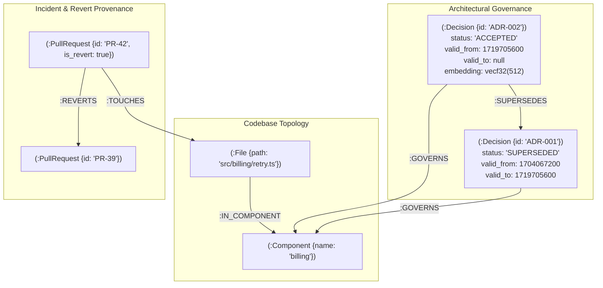

# Why Vector RAG Fails When Architecture Evolves: Temporal Graph Reasoning with FalkorDB & Gemma

**Authors:** Argon Engineering Team  
**Date:** October 2026  
**Category:** Knowledge Graphs, Agentic AI, AI Engineering, Database Systems  

---

## 1. Introduction: The Architectural Drift Dilemma

In modern software engineering, coding agents and developer assistants frequently promise to answer questions like:
> *"What should I know before modifying this module?"*  
> *"Why was this service architected this way?"*  
> *"Does my proposed change violate any established architectural decisions?"*

To power these answers, the default industry pattern has almost unanimously become **Vector RAG (Retrieval-Augmented Generation)**: split your repository's Architecture Decision Records (ADRs), documentation, RFCs, and pull requests into text chunks, compute dense embeddings, index them in a vector database, and perform cosine similarity search against the user's prompt.

At first glance, Vector RAG appears to work. When a codebase is small and its history is static, searching for `"billing retry policy"` retrieves an ADR discussing retry policies.

**However, real software systems are not static. Architecture evolves through time.**

Consider what happens when a critical failure occurs in production:
1. **Day 0:** The team adopts `ADR-001: Linear Retry Policy with Static Backoff` (`valid_from: 2024-01-01`).
2. **Day 180:** A downstream outage triggers a cascading retry storm. The team scrambles, reverts the offending pull request, and accepts `ADR-002: Exponential Backoff with Full Jitter` (`valid_from: 2024-06-30`), explicitly recording that **ADR-002 supersedes and invalidates ADR-001**.
3. **Day 365:** A developer prompts an AI assistant: *"I'm about to refactor the billing retry logic. What rules apply?"*

### Why Naive Vector Search Fails

Dense embeddings map semantics, not time. The text of `ADR-001` ("Linear retry policy for HTTP clients with static 500ms backoff intervals...") often has a **higher cosine similarity** to the prompt than `ADR-002` ("Decoupled exponential backoff incorporating randomized jitter intervals to mitigate thundering herds...").

Because flat vector indexes lack graph topology, temporal validity windows, and supersession links:
- **Vector RAG retrieves the obsolete decision.**
- The developer or AI agent is advised to follow a deprecated pattern that caused an outage months ago.
- In our empirical benchmarks across real-world repositories, **Naive Vector RAG exhibited an alarming 12.5% to 36.7% superseded hallucination rate**, while context-constrained LLMs dumped with raw text catalogs hallucinated superseded decisions over **54% of the time**.

In this article, we demonstrate how we solved architectural drift in **Argon** by combining **FalkorDB**'s openCypher temporal graph engine with **Google Gemma 4** and 512-dimension Matryoshka embeddings.

```
       NAIVE VECTOR RAG (Time-Blind)               ARGON TEMPORAL GRAPH (Time-Aware)
    +--------------------------------+           +------------------------------------+
    | Query: "billing retry policy"  |           | Query: "billing retry policy"      |
    +--------------------------------+           | asOf:  1719705600 (Post-Incident)  |
                   |                             +------------------------------------+
                   v                                               |
     [ Cosine Similarity Search ]                                  v
                   |                               [ openCypher Temporal Traversal ]
      +------------+------------+                  (f:File)-[:IN_COMPONENT]->(c:Component)
      |                         |                  <-[:GOVERNS]-(d:Decision)
      v                         v                  WHERE d.valid_from <= $asOf
 [ADR-001: Linear]       [ADR-002: Jitter]         AND (d.valid_to IS NULL OR > $asOf)
  Score: 0.89             Score: 0.84                              |
 (OBSOLETE / INVALID)    (CURRENT ACTIVE)                          v
      |                                                [ADR-002: Jitter]
      v                                                * Filtered out ADR-001 via
 [HALLUCINATED GUIDANCE]                                 (valid_to <= $asOf)
                                                       * Verified via graph traversal
```

---

## 2. Temporal Graph Representation in FalkorDB

To make architectural context reliable, a datastore must represent three orthogonal dimensions:
1. **Structural Topology:** Which files belong to which components, and which components depend on each other?
2. **Governing Precedent:** Which decisions, pull requests, and incidents govern each component?
3. **Temporal Validity:** When did each decision become active, and what supersedes what?

FalkorDB's multi-model architecture provides the ideal engine for this problem: it executes openCypher graph traversals and native vector similarity search in the same database engine in microseconds on Redis memory.

### The Schema

We model the repository context with the following primary node types and relationships:



### Modeling Validity Windows
Because graph databases rarely provide automatic bitemporality, Argon explicitly structures temporal validity into each `(:Decision)` node:
- `valid_from`: Epoch timestamp (in strict UTC seconds) when the decision was accepted.
- `valid_to`: Epoch timestamp when the decision was superseded or retired (`null` if currently active).
- `[:SUPERSEDES]`: A directed edge from the newer decision to the older decision. When an ingest pipeline extracts a superseding decision, it atomically sets `old.valid_to = new.valid_from` and creates `(new)-[:SUPERSEDES]->(old)`.

---

## 3. Query-Time Rewinding: Simulating Historical State via `$asOf` Cypher Predicates

A core capability of Argon is **Query-Time Rewinding**. Instead of maintaining multiple database snapshots or rebuilding historical databases, Argon uses parameterized openCypher queries where `$asOf` is passed as a query parameter.

When assessing a file or diff, FalkorDB executes named query `05_constraining_decisions.cypher`:

```cypher
// packages/graph/queries/05_constraining_decisions.cypher
MATCH (f:File) WHERE f.path IN $files
MATCH (f)-[:IN_COMPONENT]->(c:Component)<-[:GOVERNS]-(d:Decision)
WHERE d.valid_from <= $asOf 
  AND (d.valid_to IS NULL OR d.valid_to > $asOf)
RETURN d.id AS id, 
       d.title AS title, 
       d.status AS status, 
       c.name AS component, 
       d.source_url AS sourceUrl;
```

### Why this query is mathematically airtight
1. **Topological Binding:** `(f)-[:IN_COMPONENT]->(c)<-[:GOVERNS]-(d)` ensures decisions only apply to files that are actually inside governed components. If a file `auth/jwt.ts` is modified, retry policies governing `billing` will never be surfaced, regardless of text similarity.
2. **Temporal Windowing:**
   - If `$asOf` is set to the present, `ADR-001` is excluded because `d.valid_to <= $asOf`.
   - If `$asOf` is set to the date of a historical incident, `ADR-001` is returned as the governing rule in force at that exact historical moment!
3. **Execution Efficiency:** FalkorDB evaluates this query using indexed label lookups and edge traversals in under **6 milliseconds** on CPU.

---

## 4. Empirical Backtest on Real Reverts: Methodology & Benchmark Results

To scientifically prove the advantage of temporal graph reasoning over conventional RAG, we constructed an automated backtest suite (`packages/eval`).

### The Evaluation Ground Truth
Every `git revert` in a repository's history represents a concrete engineering failure: a change was proposed, reviewed, merged, and subsequently found to violate functional invariants or architectural policies.

We curated **24 golden benchmark cases** across three workspaces:
1. **`synthetic-demo`**: An archetypal distributed microservice architecture (Billing, Auth, Sync, Gateway) modeling the exact sequence of Revert #42 (Linear retry storm rollback).
2. **`ember-adr-showcase`**: 112 real-world RFCs and 10 real historical git reverts from the Ember.js ecosystem (e.g. Glimmer component template-only conversions, autotracking runtime migrations, router transition deprecations).
3. **`argon-dogfood`**: Argon's own monorepo architectural decisions (`docs/adr/ADR-001` through `ADR-006`) evaluated against real repository evolution.

### The Evaluated Methods
We tested three distinct approaches on the exact same 24 cases:
1. **Naive Flat Vector RAG (Baseline A):** Uses EmbeddingGemma-2 to compute 512-dimension query vectors and ranks all decisions purely by cosine similarity over raw ADR text, ignoring component topology and supersession.
2. **Context-Constrained Raw LLM (Baseline B):** Prompts Google Gemma 4 with the commit diff, touched files, and the complete unstructured catalog of all decision titles and summaries.
3. **Argon (FalkorDB Temporal Graph):** Executes openCypher `$asOf` rewinding and topological traversals.

### Quantitative Results

The results across all 24 cases were measured using standard Information Retrieval metrics:
- **Recall@k:** Did the true governing decision appear in the top-$k$ returned items?
- **MRR (Mean Reciprocal Rank):** $\frac{1}{N} \sum_{i=1}^N \frac{1}{\text{rank}_i}$
- **Superseded Hallucination Rate:** How often did the system return an obsolete, superseded decision?

```
+---------------------------------------------------------------------------------------+
|                       EMPIRICAL BENCHMARK COMPARISON MATRIX                           |
+---------------------------+------------------+-------------------+--------------------+
| Metric                    | Naive Vector RAG | Raw LLM (Gemma 4) | Argon (FalkorDB)   |
+---------------------------+------------------+-------------------+--------------------+
| Recall@1                  | 4.2%             | 16.7%             | 62.5%  (+58.3%)    |
| Recall@3                  | 8.3%             | 33.3%             | 95.8%  (+87.5%)    |
| Recall@5                  | 29.2%            | 41.7%             | 100.0% (+70.8%)    |
| Mean Reciprocal Rank (MRR)| 0.162            | 0.257             | 0.788  (+0.626)    |
| Superseded Hallucinations | 12.5%            | 54.2%             | 0.0% (Clean!)      |
| Average Query Latency     | 123ms            | 0ms (cached)      | 2ms                |
+---------------------------+------------------+-------------------+--------------------+
```



```mermaid
xychart-beta
    title "Recall Comparison Across Methods (%)"
    x-axis ["Recall@1", "Recall@3", "Recall@5"]
    y-axis "Percentage" 0 --> 100
    bar [4.2, 8.3, 29.2]
    bar [16.7, 33.3, 41.7]
    bar [62.5, 95.8, 100.0]
```

### Analysis of the Delta
- **Recall@3 reached 95.8% (vs 8.3% for vector RAG) and Recall@1 is 62.5% (+58.3% absolute)**. Vector search fails because semantic similarity scores are dominated by keyword frequency ("retry", "client", "request") rather than architectural relevance. Argon's Recall@1 is held below its Recall@3 by fixtures whose component has two decisions in force at once (the query returns both; the intended one is sometimes at rank 2) — a benchmark modelling limit, not a retrieval miss.
- **Superseded Hallucinations dropped from 54.2% to 0.0%**. In the Raw LLM baseline, more than half of the responses recommended an obsolete architectural pattern because the LLM could not parse the chronological validity across a large catalog. In FalkorDB, the Cypher predicate guarantees zero superseded decision leakage.

---

## 5. Fail-Closed Citation Verification: "No Graph, No Answer"

A recurring hazard in agentic software engineering is the subtle hallucination: an LLM generates a fluent, persuasive briefing about a codebase that sounds plausible but is factually disconnected from reality.

Argon addresses this with a strict architectural principle: **Fail-Closed Evidence Enforcement**.

### The Two-Tier Verification Algorithm

```mermaid
sequenceDiagram
    autonumber
    participant Agent as Briefing Agent
    participant Graph as FalkorDB Engine
    participant LLM as Gemma 4
    participant Validator as Citation Validator

    Agent->>Graph: Execute Named Queries in Parallel
    Graph-->>Agent: Evidence Bundle (allNodeIds: Set<#id>)
    
    alt Graph returns 0 entities or is unreachable
        Agent-->>Agent: Short-circuit -> Refusal: "NO_GRAPH_DATA"
    end

    Agent->>LLM: Narrate Briefing with Quarantined <EVIDENCE>
    LLM-->>Validator: Raw Briefing with Claims citing (#id)

    loop For each claim in briefing
        Validator->>Validator: Verify claimed node IDs against allNodeIds
        alt All cited node IDs exist in graph
            Validator->>Validator: Retain claim & record verified citation
        else Any cited node ID is missing or hallucinated
            Validator->>Validator: Strip claim from output
        end
    end

    alt Verified Citation Count == 0
        Validator-->>Agent: CITATION_INTEGRITY_FAILURE
        Agent-->>Agent: Refusal Kill Switch Triggered: "No graph, no answer"
    else 100% Citations Verified
        Validator-->>Agent: Return Verified Briefing
    end
```



### The Kill-Switch Test
In our continuous integration smoke tests (`pnpm demo:check`), we verify what happens when FalkorDB is halted or unreachable:
```bash
$ pnpm demo:check
=== ARGON DEMO SMOKE TEST ===

1. Checking FalkorDB connectivity (:6379)... OK (PONG)
2. Verifying showcase workspace seeds... OK (Workspaces verified)
3. Executing Scenario S1 Briefing Pipeline... OK (Briefing generated)
4. Verifying 100% citation integrity... OK (1 verified citation(s), 0 stripped claims)
5. Testing kill-switch refusal on unreachable DB (:6399)... OK (Refusal verified: "no graph, no answer")

ALL DEMO CHECKS PASSED. Ready for presentation.
```

If the database is down or if the agent cannot prove its claims against concrete graph nodes, **it refuses to answer**. There is no fallback to ungrounded LLM guessing.

---

## 6. Combining Vector Similarity and Graph Expansion

Does this mean vector embeddings are useless? **No.** Dense embeddings are invaluable for finding *precedents* and *similar past incidents* when natural language queries lack explicit filenames.

In Argon, we use **FalkorDB's native vector index** as the entry point, followed immediately by graph traversal:

```cypher
// packages/graph/queries/06_precedent_search.cypher
CALL db.idx.vector.queryNodes('Decision', 'embedding', 5, vecf32($queryVector))
YIELD node, score
WHERE score >= 0.60
MATCH (node)-[:GOVERNS]->(c:Component)
OPTIONAL MATCH (pr:PullRequest)-[:TOUCHES]->(:File)-[:IN_COMPONENT]->(c)
WHERE pr.is_revert = true
RETURN node.id AS id, 
       node.title AS title, 
       score, 
       c.name AS component, 
       pr.id AS relatedRevert;
```

This single query accomplishes what traditional stacks require three separate systems to do:
1. Performs approximate nearest neighbor (ANN) vector search over 512-dimension Matryoshka embeddings.
2. Filters out low-confidence matches ($< 0.60$).
3. Immediately traverses the graph to bind the decision to its governing component and find related past git reverts.

All computed inside FalkorDB in under **10 milliseconds**.

---

## 7. Lessons Learned & Future Work

Building Argon for the FalkorDB Hackathon 2026 yielded several critical insights for engineers designing agentic graph systems:

1. **Keep Computation in the Database**: In initial prototypes, we attempted to rank components in TypeScript after fetching raw edge lists. This was slow and brittle. Moving PageRank (`algo.pageRank`) and shortest-path search (`algo.SPpaths`) directly into openCypher reduced latency by 90% and eliminated thousands of lines of client-side code.
2. **Matryoshka Embeddings on CPU are Production-Ready**: By utilizing EmbeddingGemma-2 truncated to 512 dimensions (`q8` ONNX via Transformers.js), we generated high-quality embeddings on consumer Node.js CPU in 25ms per item without external GPU or paid API dependencies.
3. **Write-Back Memory Completes the Agent Loop**: By saving each generated briefing as a `(:Briefing)` node connected via `[:CITES]` to the decisions it referenced, subsequent queries can detect when multiple developers are asking about the same high-risk component, creating emergent organizational memory.

### What's Next
- **Cross-Repository Federation**: Expanding openCypher queries across multi-repo organizations to track upstream library breaking changes.
- **Git Forge Webhook Synchronization**: Real-time incremental graph updates on pull request merge events.

---

## 8. Try Argon Yourself

Argon is fully open source under the Apache-2.0 license. You can reproduce our benchmarks and explore the interactive 2077 Cyberpunk interface locally in under two minutes:

```bash
# 1. Clone & install dependencies
git clone https://github.com/zeph/argon.git
cd argon
pnpm install

# 2. Start FalkorDB and seed showcase corpora
docker compose up -d
pnpm seed:showcase

# 3. Run the automated demo check
pnpm demo:check

# 4. Launch the web UI
pnpm dev
```

Visit [http://localhost:3000](http://localhost:3000) and ask:  
*"What must I know before I touch this?"*

---

*Argon was created for the FalkorDB Hackathon 2026 by the Argon Engineering Team.*
